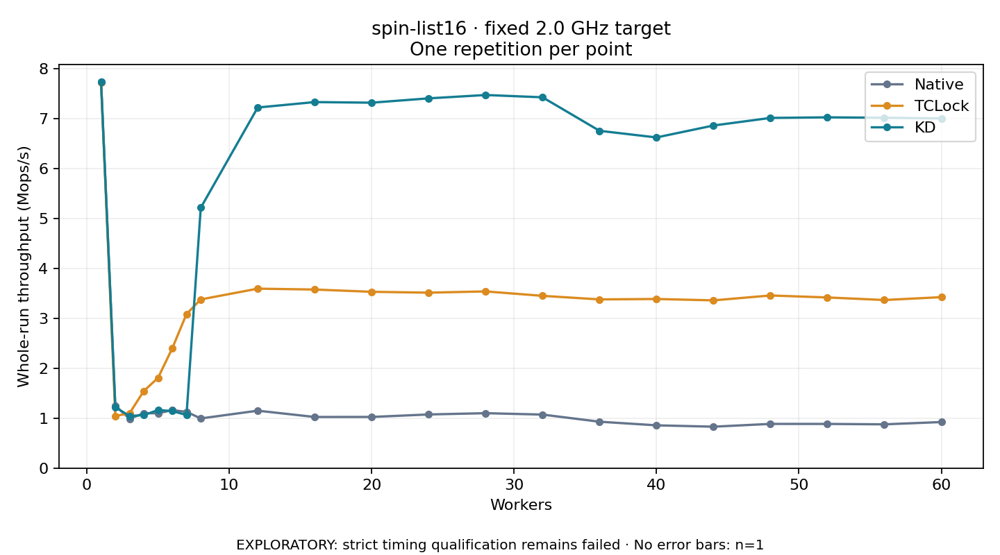

# spin-list16 · fixed 2.0 GHz target

One timed round per point. **EXPLORATORY: strict timing qualification remains failed.** Failed/unrun points have no rate; one round supplies no repeat-variability estimate.

| Workers | Native Mops/s | TCLock Mops/s | KD Mops/s | KD / Native | KD / TCLock | KD execution |
|---:|---:|---:|---:|---:|---:|:---|
| 1 | 7.728 | 7.719 | 7.736 | 1.001× | 1.002× | NO_JIT |
| 2 | 1.250 | 1.045 | 1.219 | 0.975× | 1.167× | NO_JIT |
| 3 | 0.988 | 1.098 | 1.044 | 1.057× | 0.951× | NO_JIT |
| 4 | 1.100 | 1.544 | 1.061 | 0.965× | 0.687× | NO_JIT |
| 5 | 1.098 | 1.808 | 1.163 | 1.059× | 0.643× | NO_JIT |
| 6 | 1.161 | 2.400 | 1.143 | 0.984× | 0.476× | NO_JIT |
| 7 | 1.127 | 3.086 | 1.064 | 0.944× | 0.345× | NO_JIT |
| 8 | 0.995 | 3.378 | 5.214 | 5.242× | 1.544× | RETURNED_JIT |
| 12 | 1.150 | 3.594 | 7.221 | 6.279× | 2.009× | RETURNED_JIT |
| 16 | 1.024 | 3.576 | 7.330 | 7.158× | 2.050× | RETURNED_JIT |
| 20 | 1.025 | 3.531 | 7.318 | 7.142× | 2.073× | RETURNED_JIT |
| 24 | 1.074 | 3.513 | 7.404 | 6.892× | 2.108× | RETURNED_JIT |
| 28 | 1.100 | 3.539 | 7.471 | 6.792× | 2.111× | RETURNED_JIT |
| 32 | 1.072 | 3.450 | 7.426 | 6.928× | 2.153× | RETURNED_JIT |
| 36 | 0.929 | 3.378 | 6.754 | 7.270× | 1.999× | RETURNED_JIT |
| 40 | 0.857 | 3.387 | 6.622 | 7.727× | 1.955× | RETURNED_JIT |
| 44 | 0.829 | 3.359 | 6.860 | 8.271× | 2.042× | RETURNED_JIT |
| 48 | 0.885 | 3.457 | 7.012 | 7.921× | 2.028× | RETURNED_JIT |
| 52 | 0.885 | 3.417 | 7.024 | 7.939× | 2.056× | RETURNED_JIT |
| 56 | 0.877 | 3.366 | 7.016 | 8.003× | 2.084× | RETURNED_JIT |
| 60 | 0.922 | 3.423 | 7.003 | 7.592× | 2.046× | RETURNED_JIT |

[Full-precision table](table.csv)

Frozen source: `a9aeb280a68242818aa469d8277e0c5a22fffee1`. [Archive hashes, frozen-validator replay and exact lifecycle checks](audit.json). Measured points: **63**; failed: **0**; unrun: **0**. Failed/unrun points have no throughput value. The full raw archive remains the primary receipt; compact JSON copies stay under the raw audit path.

Whole-run throughput is completed operations divided by the recorded wall interval; peak rates use the frozen full-cohort progress-window validator. Reciprocal throughput is an aggregate service interval, not operation latency. Returned completion share counts eligible writer operations (snapshot reads for the extracted snapshot cases). NO_JIT points are local execution evidence. One observation cannot establish statistical superiority.

Frequency readbacks are bound before/after this workload. Fixed frequency does not repair the separately failed strict host task-membership gate. Exact output checks and drain validate the retained execution; offline replay does not rerun kernel bodies or syscalls.

Frozen score-ineligible observations, if any, retain their separately labeled raw rate in the CSV and are excluded from the ordinary chart and ratios. Valid NO_JIT observations remain plotted.
