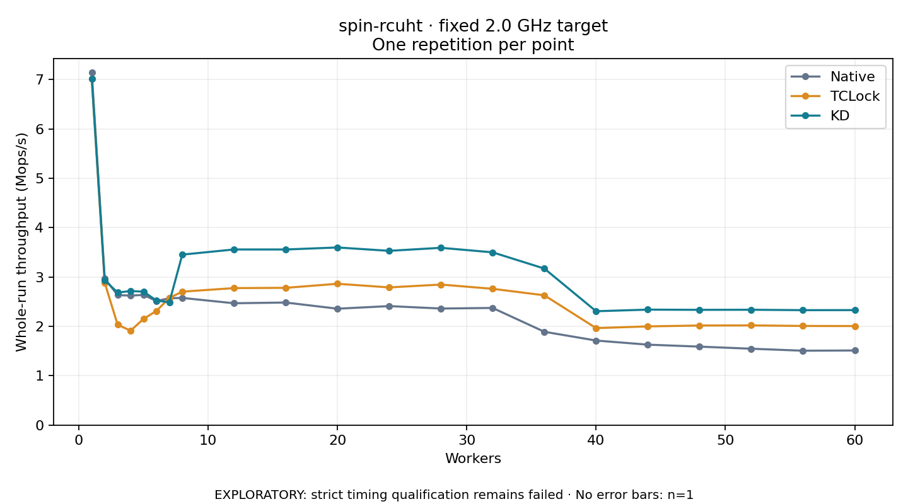

# spin-rcuht · fixed 2.0 GHz target

One timed round per point. **EXPLORATORY: strict timing qualification remains failed.** Failed/unrun points have no rate; one round supplies no repeat-variability estimate.

| Workers | Native Mops/s | TCLock Mops/s | KD Mops/s | KD / Native | KD / TCLock | KD execution |
|---:|---:|---:|---:|---:|---:|:---|
| 1 | 7.145 | 7.018 | 7.021 | 0.983× | 1.001× | NO_JIT |
| 2 | 2.973 | 2.885 | 2.935 | 0.987× | 1.017× | NO_JIT |
| 3 | 2.634 | 2.035 | 2.686 | 1.020× | 1.320× | NO_JIT |
| 4 | 2.625 | 1.912 | 2.717 | 1.035× | 1.420× | NO_JIT |
| 5 | 2.638 | 2.152 | 2.704 | 1.025× | 1.257× | NO_JIT |
| 6 | 2.514 | 2.313 | 2.524 | 1.004× | 1.091× | NO_JIT |
| 7 | 2.570 | 2.578 | 2.488 | 0.968× | 0.965× | NO_JIT |
| 8 | 2.577 | 2.704 | 3.455 | 1.341× | 1.278× | RETURNED_JIT |
| 12 | 2.469 | 2.776 | 3.559 | 1.441× | 1.282× | RETURNED_JIT |
| 16 | 2.484 | 2.781 | 3.559 | 1.433× | 1.279× | RETURNED_JIT |
| 20 | 2.359 | 2.864 | 3.599 | 1.526× | 1.257× | RETURNED_JIT |
| 24 | 2.411 | 2.790 | 3.531 | 1.464× | 1.266× | RETURNED_JIT |
| 28 | 2.362 | 2.848 | 3.593 | 1.521× | 1.261× | RETURNED_JIT |
| 32 | 2.374 | 2.762 | 3.501 | 1.475× | 1.268× | RETURNED_JIT |
| 36 | 1.891 | 2.630 | 3.172 | 1.677× | 1.206× | RETURNED_JIT |
| 40 | 1.714 | 1.965 | 2.307 | 1.347× | 1.174× | RETURNED_JIT |
| 44 | 1.630 | 2.000 | 2.340 | 1.435× | 1.170× | RETURNED_JIT |
| 48 | 1.590 | 2.018 | 2.336 | 1.469× | 1.158× | RETURNED_JIT |
| 52 | 1.548 | 2.020 | 2.337 | 1.510× | 1.157× | RETURNED_JIT |
| 56 | 1.507 | 2.009 | 2.329 | 1.545× | 1.159× | RETURNED_JIT |
| 60 | 1.512 | 2.007 | 2.330 | 1.541× | 1.161× | RETURNED_JIT |

[Full-precision table](table.csv)

Frozen source: `a9aeb280a68242818aa469d8277e0c5a22fffee1`. [Archive hashes, frozen-validator replay and exact lifecycle checks](audit.json). Measured points: **63**; failed: **0**; unrun: **0**. Failed/unrun points have no throughput value. The full raw archive remains the primary receipt; compact JSON copies stay under the raw audit path.

Whole-run throughput is completed operations divided by the recorded wall interval; peak rates use the frozen full-cohort progress-window validator. Reciprocal throughput is an aggregate service interval, not operation latency. Returned completion share counts eligible writer operations (snapshot reads for the extracted snapshot cases). NO_JIT points are local execution evidence. One observation cannot establish statistical superiority.

Frequency readbacks are bound before/after this workload. Fixed frequency does not repair the separately failed strict host task-membership gate. Exact output checks and drain validate the retained execution; offline replay does not rerun kernel bodies or syscalls.

Frozen score-ineligible observations, if any, retain their separately labeled raw rate in the CSV and are excluded from the ordinary chart and ratios. Valid NO_JIT observations remain plotted.
