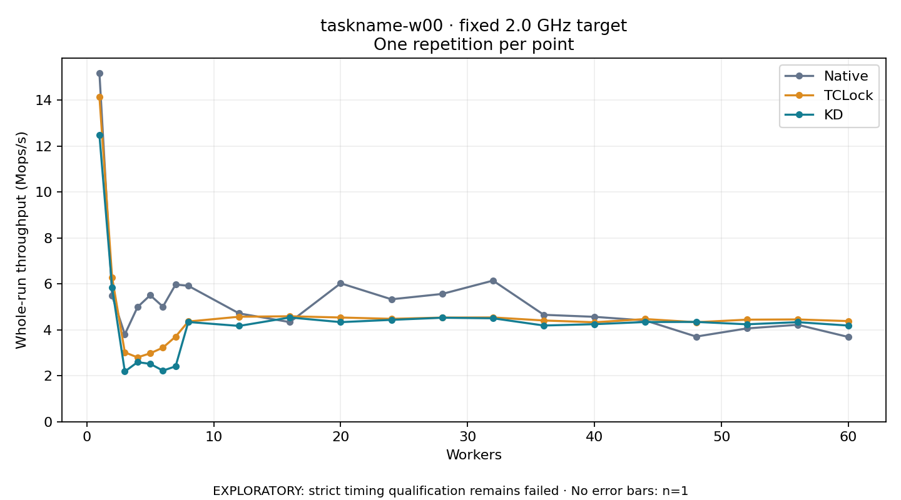

# taskname-w00 · fixed 2.0 GHz target

One timed round per point. **EXPLORATORY: strict timing qualification remains failed.** Failed/unrun points have no rate; one round supplies no repeat-variability estimate.

| Workers | Native Mops/s | TCLock Mops/s | KD Mops/s | KD / Native | KD / TCLock | KD execution |
|---:|---:|---:|---:|---:|---:|:---|
| 1 | 15.177 | 14.148 | 12.481 | 0.822× | 0.882× | NO_JIT |
| 2 | 5.477 | 6.278 | 5.834 | 1.065× | 0.929× | NO_JIT |
| 3 | 3.804 | 3.020 | 2.186 | 0.575× | 0.724× | RETURNED_JIT |
| 4 | 4.990 | 2.801 | 2.592 | 0.520× | 0.926× | RETURNED_JIT |
| 5 | 5.508 | 2.978 | 2.520 | 0.458× | 0.846× | RETURNED_JIT |
| 6 | 5.009 | 3.225 | 2.223 | 0.444× | 0.689× | RETURNED_JIT |
| 7 | 5.973 | 3.706 | 2.412 | 0.404× | 0.651× | RETURNED_JIT |
| 8 | 5.916 | 4.362 | 4.341 | 0.734× | 0.995× | RETURNED_JIT |
| 12 | 4.715 | 4.570 | 4.170 | 0.884× | 0.912× | RETURNED_JIT |
| 16 | 4.336 | 4.590 | 4.538 | 1.046× | 0.989× | RETURNED_JIT |
| 20 | 6.025 | 4.537 | 4.335 | 0.720× | 0.956× | RETURNED_JIT |
| 24 | 5.329 | 4.478 | 4.434 | 0.832× | 0.990× | RETURNED_JIT |
| 28 | 5.563 | 4.533 | 4.526 | 0.814× | 0.998× | RETURNED_JIT |
| 32 | 6.143 | 4.539 | 4.503 | 0.733× | 0.992× | RETURNED_JIT |
| 36 | 4.654 | 4.407 | 4.188 | 0.900× | 0.950× | RETURNED_JIT |
| 40 | 4.566 | 4.329 | 4.246 | 0.930× | 0.981× | RETURNED_JIT |
| 44 | 4.406 | 4.469 | 4.340 | 0.985× | 0.971× | RETURNED_JIT |
| 48 | 3.706 | 4.332 | 4.344 | 1.172× | 1.003× | RETURNED_JIT |
| 52 | 4.062 | 4.443 | 4.241 | 1.044× | 0.955× | RETURNED_JIT |
| 56 | 4.219 | 4.452 | 4.333 | 1.027× | 0.973× | RETURNED_JIT |
| 60 | 3.687 | 4.380 | 4.185 | 1.135× | 0.956× | RETURNED_JIT |

[Full-precision table](table.csv)

Frozen source: `a9aeb280a68242818aa469d8277e0c5a22fffee1`. [Archive hashes, frozen-validator replay and exact lifecycle checks](audit.json). Measured points: **63**; failed: **0**; unrun: **0**. Failed/unrun points have no throughput value. The full raw archive remains the primary receipt; compact JSON copies stay under the raw audit path.

Whole-run throughput is completed operations divided by the recorded wall interval; peak rates use the frozen full-cohort progress-window validator. Reciprocal throughput is an aggregate service interval, not operation latency. Returned completion share counts eligible writer operations (snapshot reads for the extracted snapshot cases). NO_JIT points are local execution evidence. One observation cannot establish statistical superiority.

Frequency readbacks are bound before/after this workload. Fixed frequency does not repair the separately failed strict host task-membership gate. Exact output checks and drain validate the retained execution; offline replay does not rerun kernel bodies or syscalls.

Frozen score-ineligible observations, if any, retain their separately labeled raw rate in the CSV and are excluded from the ordinary chart and ratios. Valid NO_JIT observations remain plotted.
