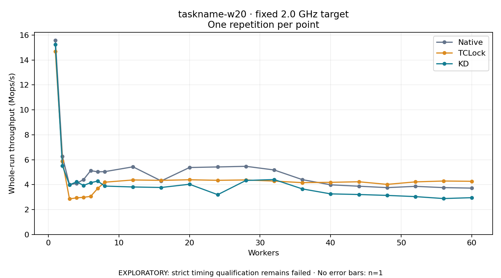

# taskname-w20 · fixed 2.0 GHz target

One timed round per point. **EXPLORATORY: strict timing qualification remains failed.** Failed/unrun points have no rate; one round supplies no repeat-variability estimate.

| Workers | Native Mops/s | TCLock Mops/s | KD Mops/s | KD / Native | KD / TCLock | KD execution |
|---:|---:|---:|---:|---:|---:|:---|
| 1 | 15.586 | 14.679 | 15.248 | 0.978× | 1.039× | NO_JIT |
| 2 | 6.258 | 5.885 | 5.524 | 0.883× | 0.939× | NO_JIT |
| 3 | 3.997 | 2.855 | 3.980 | 0.996× | 1.394× | NO_JIT |
| 4 | 4.094 | 2.940 | 4.221 | 1.031× | 1.436× | NO_JIT |
| 5 | 4.412 | 2.984 | 3.937 | 0.892× | 1.320× | NO_JIT |
| 6 | 5.121 | 3.058 | 4.152 | 0.811× | 1.358× | NO_JIT |
| 7 | 5.029 | 3.695 | 4.285 | 0.852× | 1.160× | NO_JIT |
| 8 | 5.043 | 4.195 | 3.883 | 0.770× | 0.926× | RETURNED_JIT |
| 12 | 5.429 | 4.375 | 3.812 | 0.702× | 0.871× | RETURNED_JIT |
| 16 | 4.299 | 4.344 | 3.771 | 0.877× | 0.868× | RETURNED_JIT |
| 20 | 5.374 | 4.390 | 4.031 | 0.750× | 0.918× | RETURNED_JIT |
| 24 | 5.419 | 4.348 | 3.195 | 0.590× | 0.735× | RETURNED_JIT |
| 28 | 5.470 | 4.376 | 4.336 | 0.793× | 0.991× | RETURNED_JIT |
| 32 | 5.176 | 4.284 | 4.407 | 0.851× | 1.029× | RETURNED_JIT |
| 36 | 4.400 | 4.160 | 3.655 | 0.831× | 0.879× | RETURNED_JIT |
| 40 | 3.985 | 4.185 | 3.258 | 0.818× | 0.779× | RETURNED_JIT |
| 44 | 3.874 | 4.230 | 3.207 | 0.828× | 0.758× | RETURNED_JIT |
| 48 | 3.760 | 4.020 | 3.136 | 0.834× | 0.780× | NO_JIT |
| 52 | 3.862 | 4.221 | 3.039 | 0.787× | 0.720× | RETURNED_JIT |
| 56 | 3.761 | 4.290 | 2.884 | 0.767× | 0.672× | RETURNED_JIT |
| 60 | 3.721 | 4.268 | 2.954 | 0.794× | 0.692× | RETURNED_JIT |

[Full-precision table](table.csv)

Frozen source: `a9aeb280a68242818aa469d8277e0c5a22fffee1`. [Archive hashes, frozen-validator replay and exact lifecycle checks](audit.json). Measured points: **63**; failed: **0**; unrun: **0**. Failed/unrun points have no throughput value. The full raw archive remains the primary receipt; compact JSON copies stay under the raw audit path.

Whole-run throughput is completed operations divided by the recorded wall interval; peak rates use the frozen full-cohort progress-window validator. Reciprocal throughput is an aggregate service interval, not operation latency. Returned completion share counts eligible writer operations (snapshot reads for the extracted snapshot cases). NO_JIT points are local execution evidence. One observation cannot establish statistical superiority.

Frequency readbacks are bound before/after this workload. Fixed frequency does not repair the separately failed strict host task-membership gate. Exact output checks and drain validate the retained execution; offline replay does not rerun kernel bodies or syscalls.

Frozen score-ineligible observations, if any, retain their separately labeled raw rate in the CSV and are excluded from the ordinary chart and ratios. Valid NO_JIT observations remain plotted.
