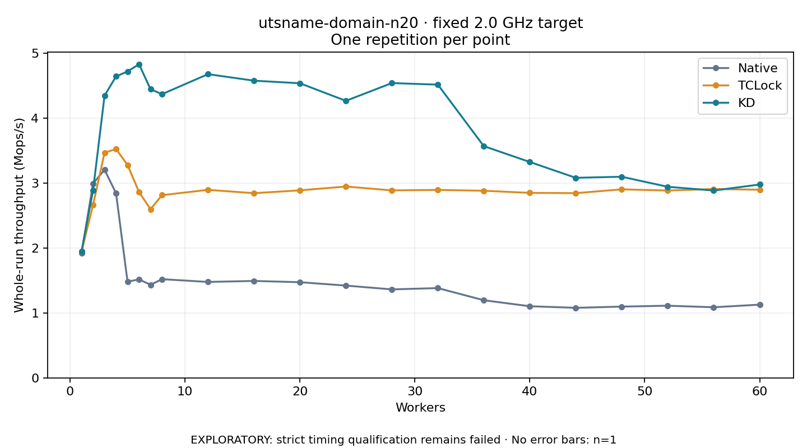

# utsname-domain-n20 · fixed 2.0 GHz target

One timed round per point. **EXPLORATORY: strict timing qualification remains failed.** Failed/unrun points have no rate; one round supplies no repeat-variability estimate.

| Workers | Native Mops/s | TCLock Mops/s | KD Mops/s | KD / Native | KD / TCLock | KD execution |
|---:|---:|---:|---:|---:|---:|:---|
| 1 | 1.922 | 1.944 | 1.952 | 1.015× | 1.004× | NO_JIT |
| 2 | 2.994 | 2.665 | 2.890 | 0.965× | 1.084× | NO_JIT |
| 3 | 3.206 | 3.469 | 4.348 | 1.356× | 1.253× | NO_JIT |
| 4 | 2.845 | 3.526 | 4.645 | 1.633× | 1.317× | NO_JIT |
| 5 | 1.482 | 3.281 | 4.722 | 3.187× | 1.439× | NO_JIT |
| 6 | 1.518 | 2.864 | 4.832 | 3.184× | 1.687× | NO_JIT |
| 7 | 1.434 | 2.599 | 4.447 | 3.101× | 1.711× | NO_JIT |
| 8 | 1.521 | 2.815 | 4.371 | 2.874× | 1.553× | NO_JIT |
| 12 | 1.478 | 2.897 | 4.679 | 3.166× | 1.615× | RETURNED_JIT |
| 16 | 1.493 | 2.846 | 4.579 | 3.066× | 1.609× | RETURNED_JIT |
| 20 | 1.474 | 2.889 | 4.539 | 3.079× | 1.571× | RETURNED_JIT |
| 24 | 1.422 | 2.948 | 4.269 | 3.002× | 1.448× | RETURNED_JIT |
| 28 | 1.363 | 2.889 | 4.542 | 3.332× | 1.572× | RETURNED_JIT |
| 32 | 1.383 | 2.896 | 4.518 | 3.266× | 1.560× | RETURNED_JIT |
| 36 | 1.196 | 2.883 | 3.570 | 2.985× | 1.238× | RETURNED_JIT |
| 40 | 1.104 | 2.851 | 3.326 | 3.014× | 1.167× | RETURNED_JIT |
| 44 | 1.079 | 2.846 | 3.083 | 2.856× | 1.083× | RETURNED_JIT |
| 48 | 1.098 | 2.905 | 3.099 | 2.823× | 1.067× | RETURNED_JIT |
| 52 | 1.112 | 2.887 | 2.944 | 2.648× | 1.020× | RETURNED_JIT |
| 56 | 1.088 | 2.910 | 2.887 | 2.653× | 0.992× | RETURNED_JIT |
| 60 | 1.128 | 2.899 | 2.979 | 2.640× | 1.028× | RETURNED_JIT |

[Full-precision table](table.csv)

Frozen source: `a9aeb280a68242818aa469d8277e0c5a22fffee1`. [Archive hashes, frozen-validator replay and exact lifecycle checks](audit.json). Measured points: **63**; failed: **0**; unrun: **0**. Failed/unrun points have no throughput value. The full raw archive remains the primary receipt; compact JSON copies stay under the raw audit path.

Whole-run throughput is completed operations divided by the recorded wall interval; peak rates use the frozen full-cohort progress-window validator. Reciprocal throughput is an aggregate service interval, not operation latency. Returned completion share counts eligible writer operations (snapshot reads for the extracted snapshot cases). NO_JIT points are local execution evidence. One observation cannot establish statistical superiority.

Frequency readbacks are bound before/after this workload. Fixed frequency does not repair the separately failed strict host task-membership gate. Exact output checks and drain validate the retained execution; offline replay does not rerun kernel bodies or syscalls.

Frozen score-ineligible observations, if any, retain their separately labeled raw rate in the CSV and are excluded from the ordinary chart and ratios. Valid NO_JIT observations remain plotted.
