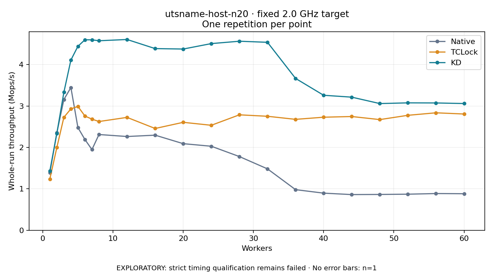

# utsname-host-n20 · fixed 2.0 GHz target

One timed round per point. **EXPLORATORY: strict timing qualification remains failed.** Failed/unrun points have no rate; one round supplies no repeat-variability estimate.

| Workers | Native Mops/s | TCLock Mops/s | KD Mops/s | KD / Native | KD / TCLock | KD execution |
|---:|---:|---:|---:|---:|---:|:---|
| 1 | 1.388 | 1.236 | 1.429 | 1.029× | 1.156× | NO_JIT |
| 2 | 2.356 | 1.998 | 2.339 | 0.993× | 1.170× | NO_JIT |
| 3 | 3.156 | 2.727 | 3.330 | 1.055× | 1.221× | NO_JIT |
| 4 | 3.445 | 2.930 | 4.108 | 1.192× | 1.402× | NO_JIT |
| 5 | 2.479 | 2.990 | 4.441 | 1.792× | 1.485× | NO_JIT |
| 6 | 2.190 | 2.757 | 4.598 | 2.099× | 1.668× | NO_JIT |
| 7 | 1.948 | 2.683 | 4.596 | 2.360× | 1.713× | NO_JIT |
| 8 | 2.311 | 2.625 | 4.575 | 1.979× | 1.743× | NO_JIT |
| 12 | 2.263 | 2.724 | 4.605 | 2.035× | 1.690× | RETURNED_JIT |
| 16 | 2.295 | 2.457 | 4.385 | 1.910× | 1.785× | RETURNED_JIT |
| 20 | 2.090 | 2.605 | 4.375 | 2.093× | 1.679× | RETURNED_JIT |
| 24 | 2.028 | 2.534 | 4.506 | 2.222× | 1.778× | RETURNED_JIT |
| 28 | 1.779 | 2.786 | 4.563 | 2.565× | 1.638× | RETURNED_JIT |
| 32 | 1.482 | 2.751 | 4.537 | 3.061× | 1.649× | RETURNED_JIT |
| 36 | 0.980 | 2.677 | 3.665 | 3.739× | 1.369× | RETURNED_JIT |
| 40 | 0.896 | 2.729 | 3.258 | 3.636× | 1.194× | RETURNED_JIT |
| 44 | 0.861 | 2.746 | 3.213 | 3.731× | 1.170× | RETURNED_JIT |
| 48 | 0.865 | 2.671 | 3.058 | 3.537× | 1.145× | RETURNED_JIT |
| 52 | 0.871 | 2.775 | 3.075 | 3.532× | 1.108× | RETURNED_JIT |
| 56 | 0.886 | 2.835 | 3.073 | 3.468× | 1.084× | RETURNED_JIT |
| 60 | 0.882 | 2.806 | 3.059 | 3.468× | 1.090× | RETURNED_JIT |

[Full-precision table](table.csv)

Frozen source: `a9aeb280a68242818aa469d8277e0c5a22fffee1`. [Archive hashes, frozen-validator replay and exact lifecycle checks](audit.json). Measured points: **63**; failed: **0**; unrun: **0**. Failed/unrun points have no throughput value. The full raw archive remains the primary receipt; compact JSON copies stay under the raw audit path.

Whole-run throughput is completed operations divided by the recorded wall interval; peak rates use the frozen full-cohort progress-window validator. Reciprocal throughput is an aggregate service interval, not operation latency. Returned completion share counts eligible writer operations (snapshot reads for the extracted snapshot cases). NO_JIT points are local execution evidence. One observation cannot establish statistical superiority.

Frequency readbacks are bound before/after this workload. Fixed frequency does not repair the separately failed strict host task-membership gate. Exact output checks and drain validate the retained execution; offline replay does not rerun kernel bodies or syscalls.

Frozen score-ineligible observations, if any, retain their separately labeled raw rate in the CSV and are excluded from the ordinary chart and ratios. Valid NO_JIT observations remain plotted.
