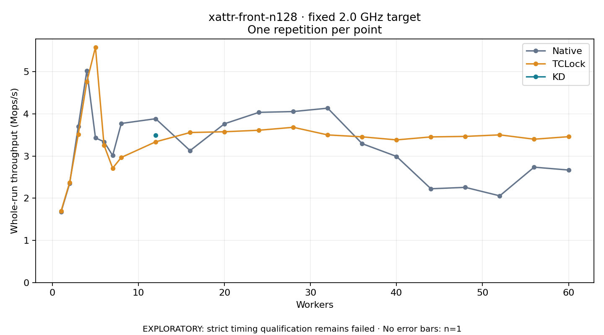

# xattr-front-n128 · fixed 2.0 GHz target

One timed round per point. **EXPLORATORY: strict timing qualification remains failed.** Failed/unrun points have no rate; one round supplies no repeat-variability estimate.

| Workers | Native Mops/s | TCLock Mops/s | KD Mops/s | KD / Native | KD / TCLock | KD execution |
|---:|---:|---:|---:|---:|---:|:---|
| 1 | 1.675 | 1.693 | — | — | — | PREPARATION_FAILED |
| 2 | 2.351 | 2.375 | — | — | — | PREPARATION_FAILED |
| 3 | 3.703 | 3.514 | — | — | — | PREPARATION_FAILED |
| 4 | 5.026 | 4.766 | — | — | — | PREPARATION_FAILED |
| 5 | 3.432 | 5.583 | — | — | — | PREPARATION_FAILED |
| 6 | 3.340 | 3.256 | — | — | — | PREPARATION_FAILED |
| 7 | 3.013 | 2.714 | — | — | — | PREPARATION_FAILED |
| 8 | 3.774 | 2.968 | — | — | — | PREPARATION_FAILED |
| 12 | 3.887 | 3.339 | 3.497 | 0.900× | 1.048× | RETURNED_JIT |
| 16 | 3.130 | 3.559 | — | — | — | PREPARATION_FAILED |
| 20 | 3.767 | 3.577 | — | — | — | PREPARATION_FAILED |
| 24 | 4.037 | 3.613 | — | — | — | PREPARATION_FAILED |
| 28 | 4.057 | 3.683 | — | — | — | PREPARATION_FAILED |
| 32 | 4.137 | 3.502 | — | — | — | PREPARATION_FAILED |
| 36 | 3.296 | 3.457 | — | — | — | PREPARATION_FAILED |
| 40 | 2.992 | 3.384 | — | — | — | PREPARATION_FAILED |
| 44 | 2.225 | 3.455 | — | — | — | PREPARATION_FAILED |
| 48 | 2.258 | 3.467 | — | — | — | PREPARATION_FAILED |
| 52 | 2.057 | 3.504 | — | — | — | PREPARATION_FAILED |
| 56 | 2.737 | 3.401 | — | — | — | PREPARATION_FAILED |
| 60 | 2.669 | 3.461 | — | — | — | PREPARATION_FAILED |

[Full-precision table](table.csv)

Frozen source: `a9aeb280a68242818aa469d8277e0c5a22fffee1`. [Archive hashes, frozen-validator replay and exact lifecycle checks](audit.json). Measured points: **43**; failed: **20**; unrun: **0**. Failed/unrun points have no throughput value. The full raw archive remains the primary receipt; compact JSON copies stay under the raw audit path.

Whole-run throughput is completed operations divided by the recorded wall interval; peak rates use the frozen full-cohort progress-window validator. Reciprocal throughput is an aggregate service interval, not operation latency. Returned completion share counts eligible writer operations (snapshot reads for the extracted snapshot cases). NO_JIT points are local execution evidence. One observation cannot establish statistical superiority.

Frequency readbacks are bound before/after this workload. Fixed frequency does not repair the separately failed strict host task-membership gate. Exact output checks and drain validate the retained execution; offline replay does not rerun kernel bodies or syscalls.

Frozen score-ineligible observations, if any, retain their separately labeled raw rate in the CSV and are excluded from the ordinary chart and ratios. Valid NO_JIT observations remain plotted.
