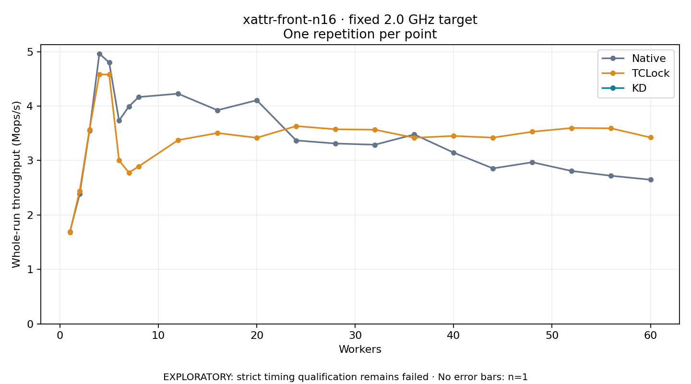

# xattr-front-n16 · fixed 2.0 GHz target

One timed round per point. **EXPLORATORY: strict timing qualification remains failed.** Failed/unrun points have no rate; one round supplies no repeat-variability estimate.

| Workers | Native Mops/s | TCLock Mops/s | KD Mops/s | KD / Native | KD / TCLock | KD execution |
|---:|---:|---:|---:|---:|---:|:---|
| 1 | 1.686 | 1.677 | — | — | — | PREPARATION_FAILED |
| 2 | 2.385 | 2.444 | — | — | — | PREPARATION_FAILED |
| 3 | 3.554 | 3.572 | — | — | — | PREPARATION_FAILED |
| 4 | 4.964 | 4.583 | — | — | — | PREPARATION_FAILED |
| 5 | 4.798 | 4.577 | — | — | — | PREPARATION_FAILED |
| 6 | 3.733 | 3.003 | — | — | — | PREPARATION_FAILED |
| 7 | 3.993 | 2.778 | — | — | — | PREPARATION_FAILED |
| 8 | 4.166 | 2.892 | — | — | — | PREPARATION_FAILED |
| 12 | 4.227 | 3.375 | — | — | — | PREPARATION_FAILED |
| 16 | 3.924 | 3.505 | — | — | — | PREPARATION_FAILED |
| 20 | 4.107 | 3.418 | — | — | — | PREPARATION_FAILED |
| 24 | 3.369 | 3.633 | — | — | — | PREPARATION_FAILED |
| 28 | 3.312 | 3.574 | — | — | — | PREPARATION_FAILED |
| 32 | 3.290 | 3.566 | — | — | — | PREPARATION_FAILED |
| 36 | 3.479 | 3.418 | — | — | — | PREPARATION_FAILED |
| 40 | 3.145 | 3.451 | — | — | — | PREPARATION_FAILED |
| 44 | 2.855 | 3.421 | — | — | — | PREPARATION_FAILED |
| 48 | 2.968 | 3.529 | — | — | — | PREPARATION_FAILED |
| 52 | 2.807 | 3.597 | — | — | — | PREPARATION_FAILED |
| 56 | 2.720 | 3.592 | — | — | — | PREPARATION_FAILED |
| 60 | 2.648 | 3.423 | — | — | — | PREPARATION_FAILED |

[Full-precision table](table.csv)

Frozen source: `a9aeb280a68242818aa469d8277e0c5a22fffee1`. [Archive hashes, frozen-validator replay and exact lifecycle checks](audit.json). Measured points: **42**; failed: **21**; unrun: **0**. Failed/unrun points have no throughput value. The full raw archive remains the primary receipt; compact JSON copies stay under the raw audit path.

Whole-run throughput is completed operations divided by the recorded wall interval; peak rates use the frozen full-cohort progress-window validator. Reciprocal throughput is an aggregate service interval, not operation latency. Returned completion share counts eligible writer operations (snapshot reads for the extracted snapshot cases). NO_JIT points are local execution evidence. One observation cannot establish statistical superiority.

Frequency readbacks are bound before/after this workload. Fixed frequency does not repair the separately failed strict host task-membership gate. Exact output checks and drain validate the retained execution; offline replay does not rerun kernel bodies or syscalls.

Frozen score-ineligible observations, if any, retain their separately labeled raw rate in the CSV and are excluded from the ordinary chart and ratios. Valid NO_JIT observations remain plotted.
