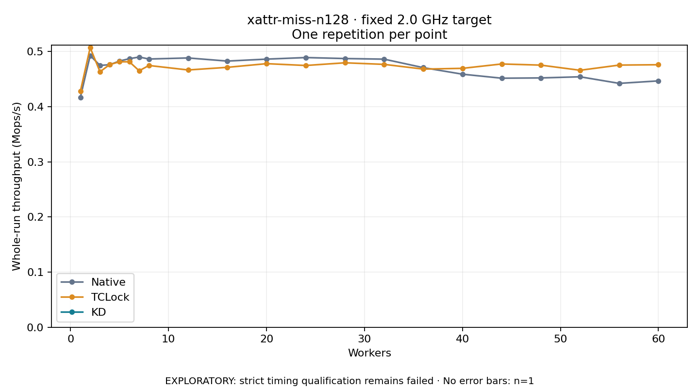

# xattr-miss-n128 · fixed 2.0 GHz target

One timed round per point. **EXPLORATORY: strict timing qualification remains failed.** Failed/unrun points have no rate; one round supplies no repeat-variability estimate.

| Workers | Native Mops/s | TCLock Mops/s | KD Mops/s | KD / Native | KD / TCLock | KD execution |
|---:|---:|---:|---:|---:|---:|:---|
| 1 | 0.417 | 0.428 | — | — | — | PREPARATION_FAILED |
| 2 | 0.493 | 0.507 | — | — | — | PREPARATION_FAILED |
| 3 | 0.475 | 0.464 | — | — | — | PREPARATION_FAILED |
| 4 | 0.476 | 0.477 | — | — | — | PREPARATION_FAILED |
| 5 | 0.483 | 0.482 | — | — | — | PREPARATION_FAILED |
| 6 | 0.487 | 0.482 | — | — | — | PREPARATION_FAILED |
| 7 | 0.490 | 0.465 | — | — | — | PREPARATION_FAILED |
| 8 | 0.487 | 0.475 | — | — | — | PREPARATION_FAILED |
| 12 | 0.489 | 0.467 | — | — | — | PREPARATION_FAILED |
| 16 | 0.483 | 0.472 | — | — | — | PREPARATION_FAILED |
| 20 | 0.486 | 0.478 | — | — | — | PREPARATION_FAILED |
| 24 | 0.489 | 0.475 | — | — | — | PREPARATION_FAILED |
| 28 | 0.487 | 0.480 | — | — | — | PREPARATION_FAILED |
| 32 | 0.486 | 0.477 | — | — | — | PREPARATION_FAILED |
| 36 | 0.471 | 0.468 | — | — | — | PREPARATION_FAILED |
| 40 | 0.459 | 0.470 | — | — | — | PREPARATION_FAILED |
| 44 | 0.452 | 0.478 | — | — | — | PREPARATION_FAILED |
| 48 | 0.452 | 0.476 | — | — | — | PREPARATION_FAILED |
| 52 | 0.454 | 0.466 | — | — | — | PREPARATION_FAILED |
| 56 | 0.442 | 0.476 | — | — | — | PREPARATION_FAILED |
| 60 | 0.447 | 0.476 | — | — | — | PREPARATION_FAILED |

[Full-precision table](table.csv)

Frozen source: `a9aeb280a68242818aa469d8277e0c5a22fffee1`. [Archive hashes, frozen-validator replay and exact lifecycle checks](audit.json). Measured points: **42**; failed: **21**; unrun: **0**. Failed/unrun points have no throughput value. The full raw archive remains the primary receipt; compact JSON copies stay under the raw audit path.

Whole-run throughput is completed operations divided by the recorded wall interval; peak rates use the frozen full-cohort progress-window validator. Reciprocal throughput is an aggregate service interval, not operation latency. Returned completion share counts eligible writer operations (snapshot reads for the extracted snapshot cases). NO_JIT points are local execution evidence. One observation cannot establish statistical superiority.

Frequency readbacks are bound before/after this workload. Fixed frequency does not repair the separately failed strict host task-membership gate. Exact output checks and drain validate the retained execution; offline replay does not rerun kernel bodies or syscalls.

Frozen score-ineligible observations, if any, retain their separately labeled raw rate in the CSV and are excluded from the ordinary chart and ratios. Valid NO_JIT observations remain plotted.
