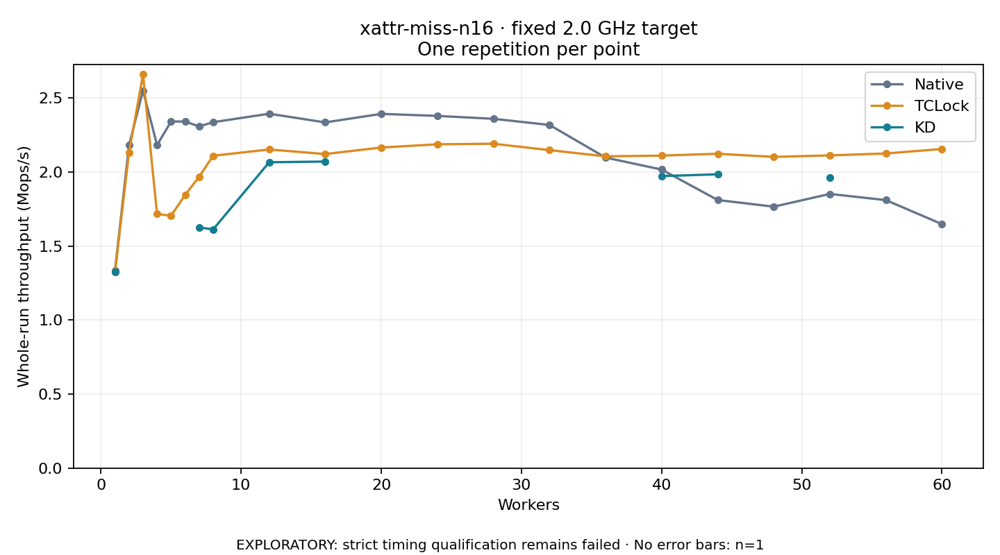

# xattr-miss-n16 · fixed 2.0 GHz target

One timed round per point. **EXPLORATORY: strict timing qualification remains failed.** Failed/unrun points have no rate; one round supplies no repeat-variability estimate.

| Workers | Native Mops/s | TCLock Mops/s | KD Mops/s | KD / Native | KD / TCLock | KD execution |
|---:|---:|---:|---:|---:|---:|:---|
| 1 | 1.334 | 1.323 | 1.328 | 0.995× | 1.003× | NO_JIT |
| 2 | 2.181 | 2.133 | — | — | — | PREPARATION_FAILED |
| 3 | 2.551 | 2.660 | — | — | — | PREPARATION_FAILED |
| 4 | 2.183 | 1.718 | — | — | — | PREPARATION_FAILED |
| 5 | 2.342 | 1.705 | — | — | — | PREPARATION_FAILED |
| 6 | 2.342 | 1.846 | — | — | — | PREPARATION_FAILED |
| 7 | 2.309 | 1.968 | 1.626 | 0.704× | 0.826× | RETURNED_JIT |
| 8 | 2.338 | 2.111 | 1.613 | 0.690× | 0.764× | RETURNED_JIT |
| 12 | 2.395 | 2.153 | 2.067 | 0.863× | 0.960× | RETURNED_JIT |
| 16 | 2.336 | 2.122 | 2.072 | 0.887× | 0.976× | RETURNED_JIT |
| 20 | 2.394 | 2.166 | — | — | — | PREPARATION_FAILED |
| 24 | 2.380 | 2.188 | — | — | — | PREPARATION_FAILED |
| 28 | 2.361 | 2.192 | — | — | — | PREPARATION_FAILED |
| 32 | 2.319 | 2.149 | — | — | — | PREPARATION_FAILED |
| 36 | 2.099 | 2.107 | — | — | — | PREPARATION_FAILED |
| 40 | 2.018 | 2.112 | 1.973 | 0.978× | 0.934× | RETURNED_JIT |
| 44 | 1.812 | 2.124 | 1.985 | 1.096× | 0.935× | RETURNED_JIT |
| 48 | 1.767 | 2.103 | — | — | — | PREPARATION_FAILED |
| 52 | 1.853 | 2.113 | 1.965 | 1.061× | 0.930× | RETURNED_JIT |
| 56 | 1.811 | 2.126 | — | — | — | PREPARATION_FAILED |
| 60 | 1.649 | 2.156 | — | — | — | PREPARATION_FAILED |

[Full-precision table](table.csv)

Frozen source: `a9aeb280a68242818aa469d8277e0c5a22fffee1`. [Archive hashes, frozen-validator replay and exact lifecycle checks](audit.json). Measured points: **50**; failed: **13**; unrun: **0**. Failed/unrun points have no throughput value. The full raw archive remains the primary receipt; compact JSON copies stay under the raw audit path.

Whole-run throughput is completed operations divided by the recorded wall interval; peak rates use the frozen full-cohort progress-window validator. Reciprocal throughput is an aggregate service interval, not operation latency. Returned completion share counts eligible writer operations (snapshot reads for the extracted snapshot cases). NO_JIT points are local execution evidence. One observation cannot establish statistical superiority.

Frequency readbacks are bound before/after this workload. Fixed frequency does not repair the separately failed strict host task-membership gate. Exact output checks and drain validate the retained execution; offline replay does not rerun kernel bodies or syscalls.

Frozen score-ineligible observations, if any, retain their separately labeled raw rate in the CSV and are excluded from the ordinary chart and ratios. Valid NO_JIT observations remain plotted.
