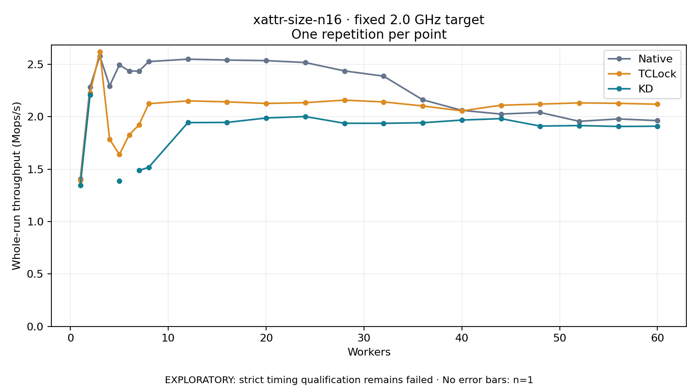

# xattr-size-n16 · fixed 2.0 GHz target

One timed round per point. **EXPLORATORY: strict timing qualification remains failed.** Failed/unrun points have no rate; one round supplies no repeat-variability estimate.

| Workers | Native Mops/s | TCLock Mops/s | KD Mops/s | KD / Native | KD / TCLock | KD execution |
|---:|---:|---:|---:|---:|---:|:---|
| 1 | 1.405 | 1.390 | 1.345 | 0.957× | 0.967× | NO_JIT |
| 2 | 2.284 | 2.226 | 2.207 | 0.966× | 0.991× | NO_JIT |
| 3 | 2.578 | 2.620 | — | — | — | PREPARATION_FAILED |
| 4 | 2.294 | 1.784 | — | — | — | PREPARATION_FAILED |
| 5 | 2.495 | 1.640 | 1.386 | 0.555× | 0.845× | RETURNED_JIT |
| 6 | 2.436 | 1.827 | — | — | — | PREPARATION_FAILED |
| 7 | 2.436 | 1.922 | 1.487 | 0.611× | 0.774× | RETURNED_JIT |
| 8 | 2.526 | 2.125 | 1.518 | 0.601× | 0.715× | RETURNED_JIT |
| 12 | 2.549 | 2.151 | 1.944 | 0.763× | 0.904× | RETURNED_JIT |
| 16 | 2.541 | 2.142 | 1.946 | 0.766× | 0.908× | RETURNED_JIT |
| 20 | 2.535 | 2.127 | 1.988 | 0.784× | 0.935× | RETURNED_JIT |
| 24 | 2.517 | 2.134 | 2.002 | 0.795× | 0.938× | RETURNED_JIT |
| 28 | 2.437 | 2.158 | 1.938 | 0.795× | 0.898× | RETURNED_JIT |
| 32 | 2.387 | 2.141 | 1.937 | 0.812× | 0.905× | RETURNED_JIT |
| 36 | 2.162 | 2.103 | 1.943 | 0.899× | 0.924× | RETURNED_JIT |
| 40 | 2.061 | 2.056 | 1.968 | 0.955× | 0.957× | RETURNED_JIT |
| 44 | 2.025 | 2.110 | 1.982 | 0.978× | 0.939× | RETURNED_JIT |
| 48 | 2.041 | 2.121 | 1.911 | 0.936× | 0.901× | RETURNED_JIT |
| 52 | 1.956 | 2.132 | 1.916 | 0.979× | 0.899× | RETURNED_JIT |
| 56 | 1.979 | 2.128 | 1.907 | 0.964× | 0.896× | RETURNED_JIT |
| 60 | 1.963 | 2.119 | 1.910 | 0.973× | 0.901× | RETURNED_JIT |

[Full-precision table](table.csv)

Frozen source: `a9aeb280a68242818aa469d8277e0c5a22fffee1`. [Archive hashes, frozen-validator replay and exact lifecycle checks](audit.json). Measured points: **60**; failed: **3**; unrun: **0**. Failed/unrun points have no throughput value. The full raw archive remains the primary receipt; compact JSON copies stay under the raw audit path.

Whole-run throughput is completed operations divided by the recorded wall interval; peak rates use the frozen full-cohort progress-window validator. Reciprocal throughput is an aggregate service interval, not operation latency. Returned completion share counts eligible writer operations (snapshot reads for the extracted snapshot cases). NO_JIT points are local execution evidence. One observation cannot establish statistical superiority.

Frequency readbacks are bound before/after this workload. Fixed frequency does not repair the separately failed strict host task-membership gate. Exact output checks and drain validate the retained execution; offline replay does not rerun kernel bodies or syscalls.

Frozen score-ineligible observations, if any, retain their separately labeled raw rate in the CSV and are excluded from the ordinary chart and ratios. Valid NO_JIT observations remain plotted.
