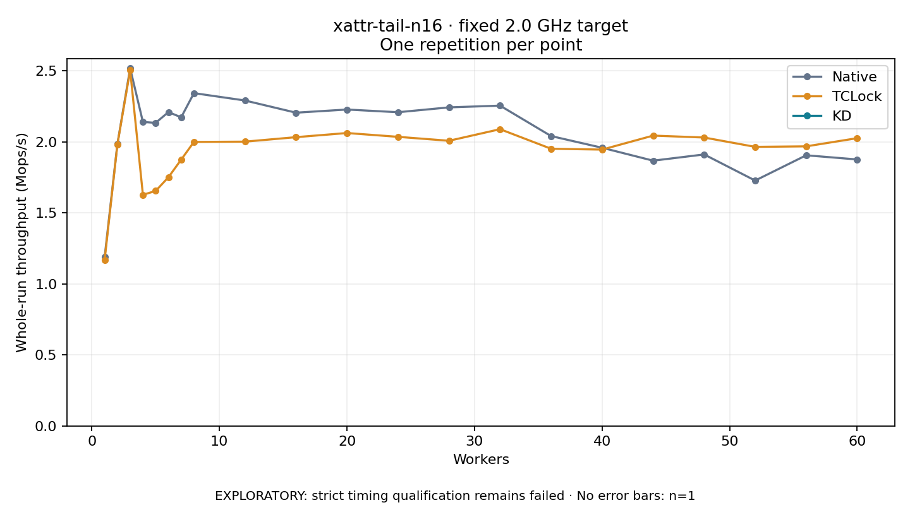

# xattr-tail-n16 · fixed 2.0 GHz target

One timed round per point. **EXPLORATORY: strict timing qualification remains failed.** Failed/unrun points have no rate; one round supplies no repeat-variability estimate.

| Workers | Native Mops/s | TCLock Mops/s | KD Mops/s | KD / Native | KD / TCLock | KD execution |
|---:|---:|---:|---:|---:|---:|:---|
| 1 | 1.188 | 1.170 | — | — | — | PREPARATION_FAILED |
| 2 | 1.984 | 1.982 | — | — | — | PREPARATION_FAILED |
| 3 | 2.518 | 2.505 | — | — | — | PREPARATION_FAILED |
| 4 | 2.140 | 1.627 | — | — | — | PREPARATION_FAILED |
| 5 | 2.134 | 1.655 | — | — | — | PREPARATION_FAILED |
| 6 | 2.210 | 1.751 | — | — | — | PREPARATION_FAILED |
| 7 | 2.173 | 1.875 | — | — | — | PREPARATION_FAILED |
| 8 | 2.343 | 2.000 | — | — | — | PREPARATION_FAILED |
| 12 | 2.292 | 2.002 | — | — | — | PREPARATION_FAILED |
| 16 | 2.206 | 2.033 | — | — | — | PREPARATION_FAILED |
| 20 | 2.228 | 2.062 | — | — | — | PREPARATION_FAILED |
| 24 | 2.209 | 2.036 | — | — | — | PREPARATION_FAILED |
| 28 | 2.243 | 2.008 | — | — | — | PREPARATION_FAILED |
| 32 | 2.255 | 2.089 | — | — | — | PREPARATION_FAILED |
| 36 | 2.041 | 1.952 | — | — | — | PREPARATION_FAILED |
| 40 | 1.959 | 1.946 | — | — | — | PREPARATION_FAILED |
| 44 | 1.868 | 2.044 | — | — | — | PREPARATION_FAILED |
| 48 | 1.912 | 2.031 | — | — | — | PREPARATION_FAILED |
| 52 | 1.728 | 1.965 | — | — | — | PREPARATION_FAILED |
| 56 | 1.906 | 1.969 | — | — | — | PREPARATION_FAILED |
| 60 | 1.876 | 2.026 | — | — | — | PREPARATION_FAILED |

[Full-precision table](table.csv)

Frozen source: `a9aeb280a68242818aa469d8277e0c5a22fffee1`. [Archive hashes, frozen-validator replay and exact lifecycle checks](audit.json). Measured points: **42**; failed: **21**; unrun: **0**. Failed/unrun points have no throughput value. The full raw archive remains the primary receipt; compact JSON copies stay under the raw audit path.

Whole-run throughput is completed operations divided by the recorded wall interval; peak rates use the frozen full-cohort progress-window validator. Reciprocal throughput is an aggregate service interval, not operation latency. Returned completion share counts eligible writer operations (snapshot reads for the extracted snapshot cases). NO_JIT points are local execution evidence. One observation cannot establish statistical superiority.

Frequency readbacks are bound before/after this workload. Fixed frequency does not repair the separately failed strict host task-membership gate. Exact output checks and drain validate the retained execution; offline replay does not rerun kernel bodies or syscalls.

Frozen score-ineligible observations, if any, retain their separately labeled raw rate in the CSV and are excluded from the ordinary chart and ratios. Valid NO_JIT observations remain plotted.
