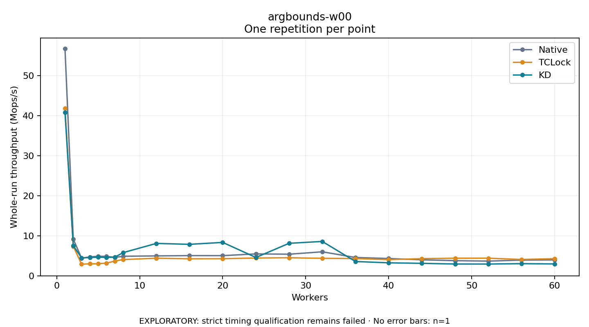

# argbounds-w00

One timed repetition per point; no repeat variability estimate.
EXPLORATORY: strict timing qualification remains failed. Rates include post-lock work. Failed/unrun cases have no plotted rate.

| Workers | Native Mops/s | TCLock Mops/s | KD Mops/s | KD execution |
| ---: | ---: | ---: | ---: | --- |
| 1 | 56.719 | 41.887 | 40.797 | NO_JIT |
| 2 | 9.161 | 7.364 | 7.498 | NO_JIT |
| 3 | 4.397 | 2.897 | 4.480 | NO_JIT |
| 4 | 4.719 | 2.989 | 4.552 | NO_JIT |
| 5 | 4.881 | 3.010 | 4.663 | NO_JIT |
| 6 | 4.857 | 3.177 | 4.573 | NO_JIT |
| 7 | 4.603 | 3.678 | 4.667 | NO_JIT |
| 8 | 4.879 | 4.064 | 5.787 | RETURNED_JIT |
| 12 | 4.976 | 4.391 | 8.093 | RETURNED_JIT |
| 16 | 5.043 | 4.252 | 7.863 | RETURNED_JIT |
| 20 | 5.038 | 4.272 | 8.349 | RETURNED_JIT |
| 24 | 5.469 | 4.445 | 4.580 | NO_JIT |
| 28 | 5.395 | 4.513 | 8.123 | RETURNED_JIT |
| 32 | 5.999 | 4.371 | 8.585 | RETURNED_JIT |
| 36 | 4.577 | 4.303 | 3.571 | RETURNED_JIT |
| 40 | 4.324 | 4.038 | 3.248 | NO_JIT |
| 44 | 3.999 | 4.289 | 3.113 | NO_JIT |
| 48 | 3.787 | 4.396 | 2.944 | NO_JIT |
| 52 | 3.668 | 4.399 | 2.936 | NO_JIT |
| 56 | 3.925 | 4.086 | 3.039 | NO_JIT |
| 60 | 3.974 | 4.284 | 2.964 | NO_JIT |

[Full receipt table](table.csv)

