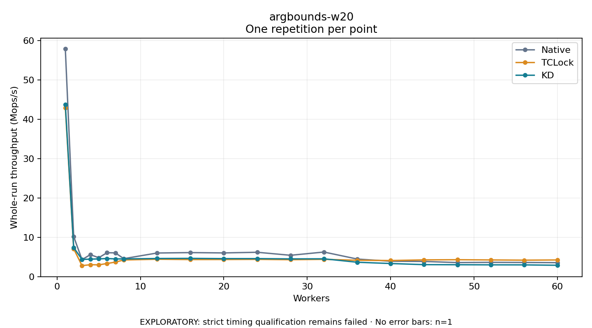

# argbounds-w20

One timed repetition per point; no repeat variability estimate.
EXPLORATORY: strict timing qualification remains failed. Rates include post-lock work. Failed/unrun cases have no plotted rate.

| Workers | Native Mops/s | TCLock Mops/s | KD Mops/s | KD execution |
| ---: | ---: | ---: | ---: | --- |
| 1 | 57.920 | 42.954 | 43.774 | NO_JIT |
| 2 | 10.214 | 7.100 | 7.404 | NO_JIT |
| 3 | 4.329 | 2.797 | 4.382 | NO_JIT |
| 4 | 5.598 | 3.044 | 4.454 | NO_JIT |
| 5 | 4.814 | 2.997 | 4.514 | NO_JIT |
| 6 | 6.088 | 3.349 | 4.613 | NO_JIT |
| 7 | 6.048 | 3.696 | 4.508 | NO_JIT |
| 8 | 4.577 | 4.243 | 4.509 | RETURNED_JIT |
| 12 | 6.016 | 4.429 | 4.617 | RETURNED_JIT |
| 16 | 6.117 | 4.347 | 4.649 | NO_JIT |
| 20 | 6.037 | 4.357 | 4.588 | RETURNED_JIT |
| 24 | 6.203 | 4.395 | 4.588 | NO_JIT |
| 28 | 5.435 | 4.309 | 4.520 | NO_JIT |
| 32 | 6.263 | 4.402 | 4.540 | NO_JIT |
| 36 | 4.475 | 4.169 | 3.664 | NO_JIT |
| 40 | 3.922 | 4.099 | 3.339 | NO_JIT |
| 44 | 3.870 | 4.270 | 3.055 | RETURNED_JIT |
| 48 | 3.579 | 4.307 | 3.032 | RETURNED_JIT |
| 52 | 3.640 | 4.253 | 3.006 | NO_JIT |
| 56 | 3.610 | 4.197 | 2.996 | RETURNED_JIT |
| 60 | 3.556 | 4.248 | 2.894 | NO_JIT |

[Full receipt table](table.csv)

