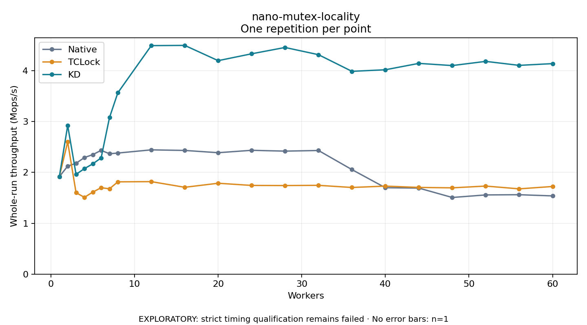

# nano-mutex-locality

One timed repetition per point; no repeat variability estimate.
EXPLORATORY: strict timing qualification remains failed. Rates include post-lock work. Failed/unrun cases have no plotted rate.

| Workers | Native Mops/s | TCLock Mops/s | KD Mops/s | KD execution |
| ---: | ---: | ---: | ---: | --- |
| 1 | 1.917 | 1.918 | 1.917 | NO_JIT |
| 2 | 2.124 | 2.600 | 2.924 | NO_JIT |
| 3 | 2.180 | 1.602 | 1.962 | RETURNED_JIT |
| 4 | 2.292 | 1.510 | 2.075 | RETURNED_JIT |
| 5 | 2.350 | 1.613 | 2.169 | RETURNED_JIT |
| 6 | 2.434 | 1.700 | 2.285 | RETURNED_JIT |
| 7 | 2.368 | 1.678 | 3.079 | RETURNED_JIT |
| 8 | 2.381 | 1.815 | 3.567 | RETURNED_JIT |
| 12 | 2.444 | 1.819 | 4.494 | RETURNED_JIT |
| 16 | 2.433 | 1.708 | 4.499 | RETURNED_JIT |
| 20 | 2.388 | 1.787 | 4.199 | RETURNED_JIT |
| 24 | 2.435 | 1.745 | 4.334 | RETURNED_JIT |
| 28 | 2.419 | 1.742 | 4.458 | RETURNED_JIT |
| 32 | 2.432 | 1.746 | 4.316 | RETURNED_JIT |
| 36 | 2.056 | 1.704 | 3.989 | RETURNED_JIT |
| 40 | 1.699 | 1.731 | 4.019 | RETURNED_JIT |
| 44 | 1.692 | 1.705 | 4.145 | RETURNED_JIT |
| 48 | 1.507 | 1.697 | 4.102 | RETURNED_JIT |
| 52 | 1.558 | 1.732 | 4.184 | RETURNED_JIT |
| 56 | 1.562 | 1.677 | 4.106 | RETURNED_JIT |
| 60 | 1.539 | 1.724 | 4.140 | RETURNED_JIT |

[Full receipt table](table.csv)

