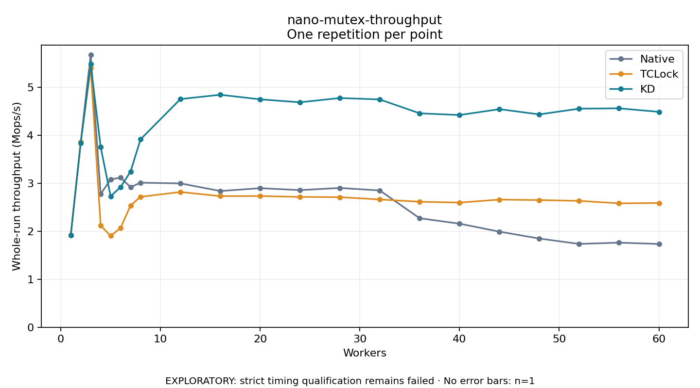

# nano-mutex-throughput

One timed repetition per point; no repeat variability estimate.
EXPLORATORY: strict timing qualification remains failed. Rates include post-lock work. Failed/unrun cases have no plotted rate.

| Workers | Native Mops/s | TCLock Mops/s | KD Mops/s | KD execution |
| ---: | ---: | ---: | ---: | --- |
| 1 | 1.915 | 1.917 | 1.913 | NO_JIT |
| 2 | 3.853 | 3.856 | 3.834 | NO_JIT |
| 3 | 5.677 | 5.400 | 5.477 | NO_JIT |
| 4 | 2.774 | 2.119 | 3.751 | RETURNED_JIT |
| 5 | 3.078 | 1.901 | 2.728 | RETURNED_JIT |
| 6 | 3.115 | 2.068 | 2.920 | RETURNED_JIT |
| 7 | 2.916 | 2.537 | 3.243 | RETURNED_JIT |
| 8 | 3.010 | 2.716 | 3.913 | RETURNED_JIT |
| 12 | 2.995 | 2.816 | 4.751 | RETURNED_JIT |
| 16 | 2.837 | 2.730 | 4.841 | RETURNED_JIT |
| 20 | 2.896 | 2.732 | 4.745 | RETURNED_JIT |
| 24 | 2.855 | 2.714 | 4.684 | RETURNED_JIT |
| 28 | 2.900 | 2.709 | 4.773 | RETURNED_JIT |
| 32 | 2.848 | 2.661 | 4.743 | RETURNED_JIT |
| 36 | 2.270 | 2.613 | 4.454 | RETURNED_JIT |
| 40 | 2.156 | 2.596 | 4.419 | RETURNED_JIT |
| 44 | 1.991 | 2.658 | 4.541 | RETURNED_JIT |
| 48 | 1.847 | 2.648 | 4.432 | RETURNED_JIT |
| 52 | 1.735 | 2.632 | 4.551 | RETURNED_JIT |
| 56 | 1.761 | 2.580 | 4.558 | RETURNED_JIT |
| 60 | 1.734 | 2.588 | 4.485 | RETURNED_JIT |

[Full receipt table](table.csv)

