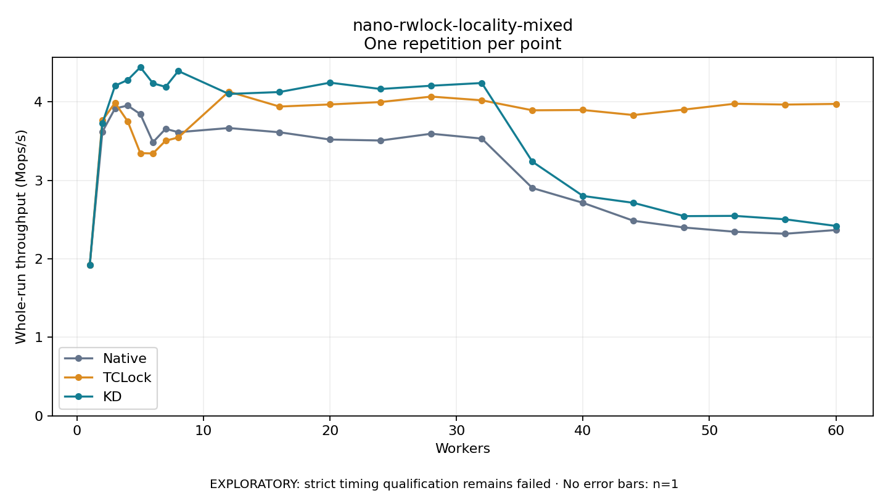

# nano-rwlock-locality-mixed

One timed repetition per point; no repeat variability estimate.
EXPLORATORY: strict timing qualification remains failed. Rates include post-lock work. Failed/unrun cases have no plotted rate.

| Workers | Native Mops/s | TCLock Mops/s | KD Mops/s | KD execution |
| ---: | ---: | ---: | ---: | --- |
| 1 | 1.917 | 1.918 | 1.919 | NO_JIT |
| 2 | 3.618 | 3.763 | 3.726 | NO_JIT |
| 3 | 3.915 | 3.987 | 4.205 | NO_JIT |
| 4 | 3.951 | 3.751 | 4.277 | NO_JIT |
| 5 | 3.842 | 3.346 | 4.440 | NO_JIT |
| 6 | 3.485 | 3.342 | 4.235 | NO_JIT |
| 7 | 3.655 | 3.504 | 4.190 | NO_JIT |
| 8 | 3.612 | 3.545 | 4.392 | NO_JIT |
| 12 | 3.665 | 4.129 | 4.099 | RETURNED_JIT |
| 16 | 3.611 | 3.939 | 4.124 | RETURNED_JIT |
| 20 | 3.519 | 3.966 | 4.243 | RETURNED_JIT |
| 24 | 3.507 | 3.996 | 4.162 | RETURNED_JIT |
| 28 | 3.593 | 4.066 | 4.204 | RETURNED_JIT |
| 32 | 3.531 | 4.019 | 4.239 | RETURNED_JIT |
| 36 | 2.901 | 3.891 | 3.237 | RETURNED_JIT |
| 40 | 2.713 | 3.895 | 2.800 | RETURNED_JIT |
| 44 | 2.484 | 3.831 | 2.712 | RETURNED_JIT |
| 48 | 2.398 | 3.900 | 2.543 | RETURNED_JIT |
| 52 | 2.344 | 3.975 | 2.547 | RETURNED_JIT |
| 56 | 2.319 | 3.964 | 2.503 | RETURNED_JIT |
| 60 | 2.366 | 3.972 | 2.418 | RETURNED_JIT |

[Full receipt table](table.csv)

