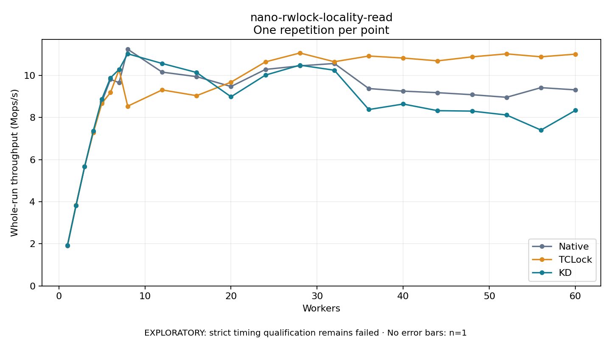

# nano-rwlock-locality-read

One timed repetition per point; no repeat variability estimate.
EXPLORATORY: strict timing qualification remains failed. Rates include post-lock work. Failed/unrun cases have no plotted rate.

| Workers | Native Mops/s | TCLock Mops/s | KD Mops/s | KD execution |
| ---: | ---: | ---: | ---: | --- |
| 1 | 1.917 | 1.918 | 1.919 | NO_JIT |
| 2 | 3.824 | 3.847 | 3.825 | NO_JIT |
| 3 | 5.676 | 5.669 | 5.667 | NO_JIT |
| 4 | 7.295 | 7.279 | 7.359 | NO_JIT |
| 5 | 8.749 | 8.677 | 8.879 | NO_JIT |
| 6 | 9.816 | 9.187 | 9.887 | NO_JIT |
| 7 | 9.656 | 10.277 | 10.285 | NO_JIT |
| 8 | 11.246 | 8.540 | 11.030 | NO_JIT |
| 12 | 10.158 | 9.312 | 10.570 | NO_JIT |
| 16 | 9.944 | 9.039 | 10.141 | NO_JIT |
| 20 | 9.474 | 9.681 | 8.987 | NO_JIT |
| 24 | 10.286 | 10.645 | 10.017 | RETURNED_JIT |
| 28 | 10.457 | 11.067 | 10.489 | RETURNED_JIT |
| 32 | 10.569 | 10.651 | 10.248 | RETURNED_JIT |
| 36 | 9.378 | 10.923 | 8.381 | RETURNED_JIT |
| 40 | 9.255 | 10.828 | 8.643 | RETURNED_JIT |
| 44 | 9.181 | 10.694 | 8.326 | RETURNED_JIT |
| 48 | 9.085 | 10.884 | 8.306 | RETURNED_JIT |
| 52 | 8.962 | 11.025 | 8.121 | RETURNED_JIT |
| 56 | 9.420 | 10.886 | 7.405 | RETURNED_JIT |
| 60 | 9.316 | 11.011 | 8.340 | RETURNED_JIT |

[Full receipt table](table.csv)

