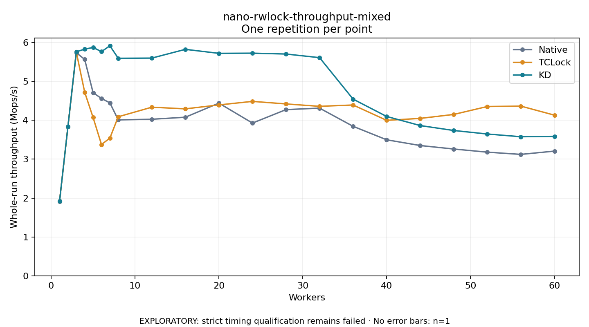

# nano-rwlock-throughput-mixed

One timed repetition per point; no repeat variability estimate.
EXPLORATORY: strict timing qualification remains failed. Rates include post-lock work. Failed/unrun cases have no plotted rate.

| Workers | Native Mops/s | TCLock Mops/s | KD Mops/s | KD execution |
| ---: | ---: | ---: | ---: | --- |
| 1 | 1.916 | 1.917 | 1.917 | NO_JIT |
| 2 | 3.835 | 3.835 | 3.838 | NO_JIT |
| 3 | 5.740 | 5.755 | 5.764 | NO_JIT |
| 4 | 5.567 | 4.723 | 5.831 | NO_JIT |
| 5 | 4.712 | 4.074 | 5.875 | NO_JIT |
| 6 | 4.563 | 3.378 | 5.767 | NO_JIT |
| 7 | 4.450 | 3.542 | 5.917 | NO_JIT |
| 8 | 4.011 | 4.092 | 5.596 | NO_JIT |
| 12 | 4.028 | 4.338 | 5.601 | RETURNED_JIT |
| 16 | 4.080 | 4.295 | 5.826 | RETURNED_JIT |
| 20 | 4.443 | 4.396 | 5.723 | RETURNED_JIT |
| 24 | 3.929 | 4.487 | 5.728 | RETURNED_JIT |
| 28 | 4.276 | 4.422 | 5.706 | RETURNED_JIT |
| 32 | 4.314 | 4.360 | 5.612 | RETURNED_JIT |
| 36 | 3.846 | 4.394 | 4.545 | RETURNED_JIT |
| 40 | 3.499 | 4.000 | 4.099 | RETURNED_JIT |
| 44 | 3.352 | 4.050 | 3.865 | RETURNED_JIT |
| 48 | 3.262 | 4.152 | 3.738 | RETURNED_JIT |
| 52 | 3.181 | 4.356 | 3.648 | RETURNED_JIT |
| 56 | 3.124 | 4.366 | 3.578 | RETURNED_JIT |
| 60 | 3.208 | 4.133 | 3.588 | RETURNED_JIT |

[Full receipt table](table.csv)

