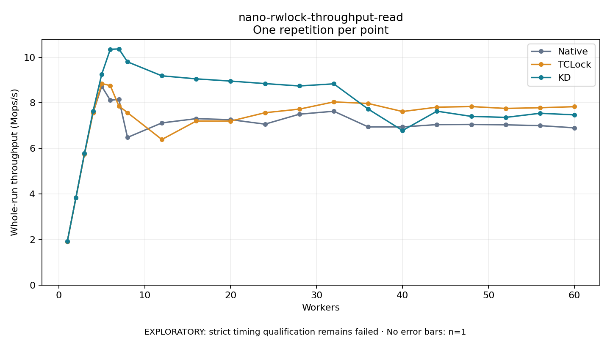

# nano-rwlock-throughput-read

One timed repetition per point; no repeat variability estimate.
EXPLORATORY: strict timing qualification remains failed. Rates include post-lock work. Failed/unrun cases have no plotted rate.

| Workers | Native Mops/s | TCLock Mops/s | KD Mops/s | KD execution |
| ---: | ---: | ---: | ---: | --- |
| 1 | 1.914 | 1.913 | 1.917 | NO_JIT |
| 2 | 3.837 | 3.835 | 3.838 | NO_JIT |
| 3 | 5.779 | 5.752 | 5.783 | NO_JIT |
| 4 | 7.571 | 7.554 | 7.641 | NO_JIT |
| 5 | 8.727 | 8.849 | 9.252 | NO_JIT |
| 6 | 8.113 | 8.757 | 10.352 | NO_JIT |
| 7 | 8.155 | 7.860 | 10.366 | NO_JIT |
| 8 | 6.481 | 7.570 | 9.800 | NO_JIT |
| 12 | 7.119 | 6.391 | 9.185 | NO_JIT |
| 16 | 7.306 | 7.201 | 9.052 | NO_JIT |
| 20 | 7.261 | 7.199 | 8.955 | NO_JIT |
| 24 | 7.065 | 7.567 | 8.844 | RETURNED_JIT |
| 28 | 7.502 | 7.724 | 8.741 | RETURNED_JIT |
| 32 | 7.632 | 8.041 | 8.834 | RETURNED_JIT |
| 36 | 6.944 | 7.972 | 7.726 | RETURNED_JIT |
| 40 | 6.944 | 7.618 | 6.785 | RETURNED_JIT |
| 44 | 7.044 | 7.810 | 7.634 | RETURNED_JIT |
| 48 | 7.052 | 7.837 | 7.406 | RETURNED_JIT |
| 52 | 7.034 | 7.754 | 7.361 | RETURNED_JIT |
| 56 | 6.999 | 7.786 | 7.542 | RETURNED_JIT |
| 60 | 6.903 | 7.832 | 7.472 | RETURNED_JIT |

[Full receipt table](table.csv)

