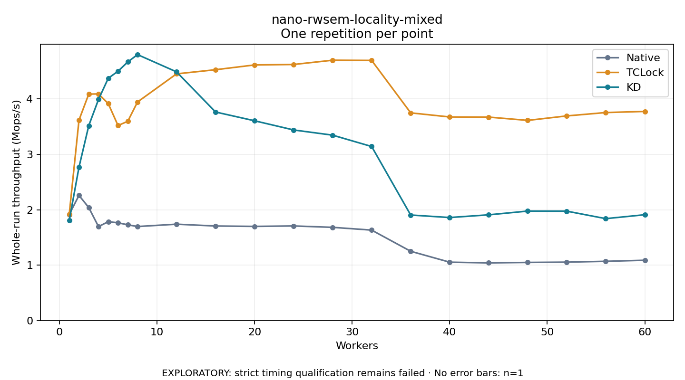

# nano-rwsem-locality-mixed

One timed repetition per point; no repeat variability estimate.
EXPLORATORY: strict timing qualification remains failed. Rates include post-lock work. Failed/unrun cases have no plotted rate.

| Workers | Native Mops/s | TCLock Mops/s | KD Mops/s | KD execution |
| ---: | ---: | ---: | ---: | --- |
| 1 | 1.915 | 1.918 | 1.806 | NO_JIT |
| 2 | 2.260 | 3.619 | 2.768 | NO_JIT |
| 3 | 2.040 | 4.088 | 3.518 | NO_JIT |
| 4 | 1.696 | 4.091 | 3.991 | RETURNED_JIT |
| 5 | 1.784 | 3.917 | 4.374 | RETURNED_JIT |
| 6 | 1.764 | 3.521 | 4.501 | RETURNED_JIT |
| 7 | 1.728 | 3.597 | 4.668 | RETURNED_JIT |
| 8 | 1.697 | 3.946 | 4.801 | RETURNED_JIT |
| 12 | 1.739 | 4.454 | 4.489 | RETURNED_JIT |
| 16 | 1.706 | 4.528 | 3.765 | RETURNED_JIT |
| 20 | 1.699 | 4.615 | 3.606 | RETURNED_JIT |
| 24 | 1.707 | 4.623 | 3.441 | RETURNED_JIT |
| 28 | 1.682 | 4.700 | 3.347 | RETURNED_JIT |
| 32 | 1.632 | 4.696 | 3.142 | RETURNED_JIT |
| 36 | 1.250 | 3.749 | 1.905 | RETURNED_JIT |
| 40 | 1.053 | 3.675 | 1.859 | RETURNED_JIT |
| 44 | 1.040 | 3.673 | 1.908 | RETURNED_JIT |
| 48 | 1.049 | 3.614 | 1.976 | RETURNED_JIT |
| 52 | 1.054 | 3.694 | 1.975 | RETURNED_JIT |
| 56 | 1.069 | 3.755 | 1.839 | RETURNED_JIT |
| 60 | 1.088 | 3.775 | 1.910 | RETURNED_JIT |

[Full receipt table](table.csv)

