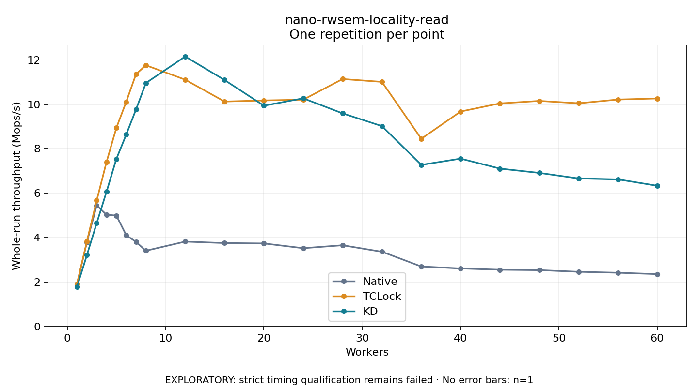

# nano-rwsem-locality-read

One timed repetition per point; no repeat variability estimate.
EXPLORATORY: strict timing qualification remains failed. Rates include post-lock work. Failed/unrun cases have no plotted rate.

| Workers | Native Mops/s | TCLock Mops/s | KD Mops/s | KD execution |
| ---: | ---: | ---: | ---: | --- |
| 1 | 1.914 | 1.915 | 1.784 | NO_JIT |
| 2 | 3.789 | 3.828 | 3.209 | NO_JIT |
| 3 | 5.447 | 5.670 | 4.648 | NO_JIT |
| 4 | 5.028 | 7.405 | 6.065 | NO_JIT |
| 5 | 4.991 | 8.938 | 7.539 | NO_JIT |
| 6 | 4.107 | 10.108 | 8.634 | NO_JIT |
| 7 | 3.805 | 11.356 | 9.769 | NO_JIT |
| 8 | 3.409 | 11.756 | 10.955 | NO_JIT |
| 12 | 3.819 | 11.107 | 12.150 | NO_JIT |
| 16 | 3.753 | 10.122 | 11.090 | NO_JIT |
| 20 | 3.736 | 10.172 | 9.936 | NO_JIT |
| 24 | 3.523 | 10.207 | 10.268 | NO_JIT |
| 28 | 3.654 | 11.136 | 9.590 | NO_JIT |
| 32 | 3.362 | 11.008 | 9.016 | NO_JIT |
| 36 | 2.698 | 8.447 | 7.272 | NO_JIT |
| 40 | 2.609 | 9.673 | 7.554 | NO_JIT |
| 44 | 2.551 | 10.039 | 7.104 | NO_JIT |
| 48 | 2.534 | 10.151 | 6.911 | NO_JIT |
| 52 | 2.459 | 10.045 | 6.661 | NO_JIT |
| 56 | 2.417 | 10.213 | 6.619 | NO_JIT |
| 60 | 2.355 | 10.261 | 6.332 | NO_JIT |

[Full receipt table](table.csv)

