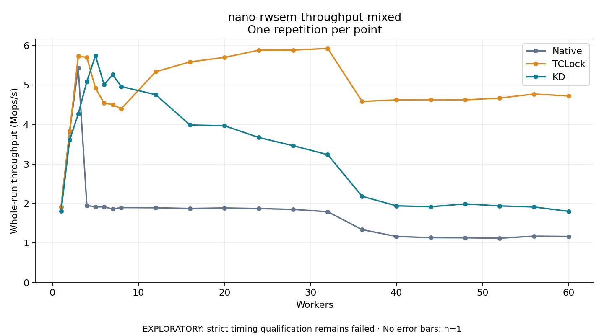

# nano-rwsem-throughput-mixed

One timed repetition per point; no repeat variability estimate.
EXPLORATORY: strict timing qualification remains failed. Rates include post-lock work. Failed/unrun cases have no plotted rate.

| Workers | Native Mops/s | TCLock Mops/s | KD Mops/s | KD execution |
| ---: | ---: | ---: | ---: | --- |
| 1 | 1.915 | 1.917 | 1.809 | NO_JIT |
| 2 | 3.832 | 3.835 | 3.610 | NO_JIT |
| 3 | 5.441 | 5.737 | 4.273 | NO_JIT |
| 4 | 1.954 | 5.703 | 5.093 | NO_JIT |
| 5 | 1.917 | 4.925 | 5.750 | RETURNED_JIT |
| 6 | 1.921 | 4.547 | 5.014 | NO_JIT |
| 7 | 1.864 | 4.508 | 5.265 | NO_JIT |
| 8 | 1.900 | 4.403 | 4.965 | NO_JIT |
| 12 | 1.895 | 5.341 | 4.760 | NO_JIT |
| 16 | 1.878 | 5.590 | 3.991 | NO_JIT |
| 20 | 1.890 | 5.704 | 3.972 | NO_JIT |
| 24 | 1.876 | 5.888 | 3.674 | NO_JIT |
| 28 | 1.853 | 5.890 | 3.466 | NO_JIT |
| 32 | 1.795 | 5.931 | 3.240 | NO_JIT |
| 36 | 1.341 | 4.589 | 2.184 | RETURNED_JIT |
| 40 | 1.168 | 4.628 | 1.943 | RETURNED_JIT |
| 44 | 1.138 | 4.630 | 1.922 | RETURNED_JIT |
| 48 | 1.134 | 4.628 | 1.992 | RETURNED_JIT |
| 52 | 1.123 | 4.673 | 1.942 | RETURNED_JIT |
| 56 | 1.177 | 4.776 | 1.916 | RETURNED_JIT |
| 60 | 1.168 | 4.726 | 1.803 | RETURNED_JIT |

[Full receipt table](table.csv)

