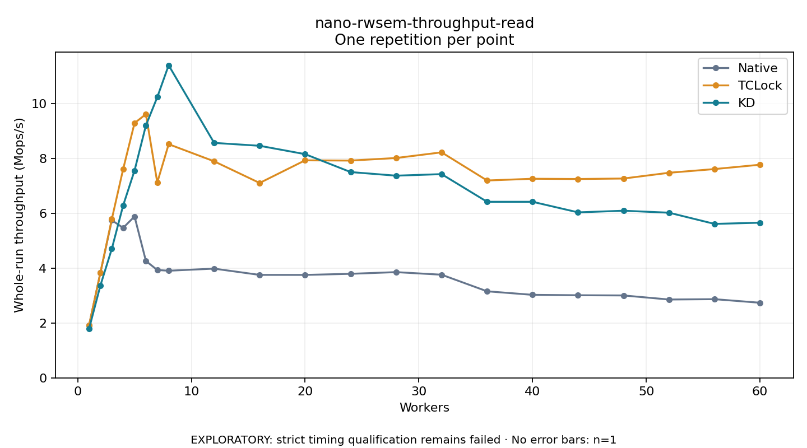

# nano-rwsem-throughput-read

One timed repetition per point; no repeat variability estimate.
EXPLORATORY: strict timing qualification remains failed. Rates include post-lock work. Failed/unrun cases have no plotted rate.

| Workers | Native Mops/s | TCLock Mops/s | KD Mops/s | KD execution |
| ---: | ---: | ---: | ---: | --- |
| 1 | 1.913 | 1.916 | 1.787 | NO_JIT |
| 2 | 3.831 | 3.836 | 3.368 | NO_JIT |
| 3 | 5.742 | 5.780 | 4.698 | NO_JIT |
| 4 | 5.466 | 7.607 | 6.284 | NO_JIT |
| 5 | 5.879 | 9.283 | 7.552 | NO_JIT |
| 6 | 4.258 | 9.605 | 9.195 | NO_JIT |
| 7 | 3.930 | 7.117 | 10.226 | NO_JIT |
| 8 | 3.903 | 8.512 | 11.387 | NO_JIT |
| 12 | 3.979 | 7.889 | 8.560 | NO_JIT |
| 16 | 3.751 | 7.100 | 8.454 | NO_JIT |
| 20 | 3.750 | 7.925 | 8.150 | NO_JIT |
| 24 | 3.790 | 7.916 | 7.497 | NO_JIT |
| 28 | 3.852 | 8.009 | 7.365 | NO_JIT |
| 32 | 3.758 | 8.216 | 7.422 | NO_JIT |
| 36 | 3.154 | 7.190 | 6.414 | NO_JIT |
| 40 | 3.025 | 7.253 | 6.414 | NO_JIT |
| 44 | 3.010 | 7.244 | 6.029 | NO_JIT |
| 48 | 3.002 | 7.261 | 6.089 | NO_JIT |
| 52 | 2.854 | 7.471 | 6.017 | NO_JIT |
| 56 | 2.866 | 7.606 | 5.609 | NO_JIT |
| 60 | 2.737 | 7.764 | 5.652 | NO_JIT |

[Full receipt table](table.csv)

