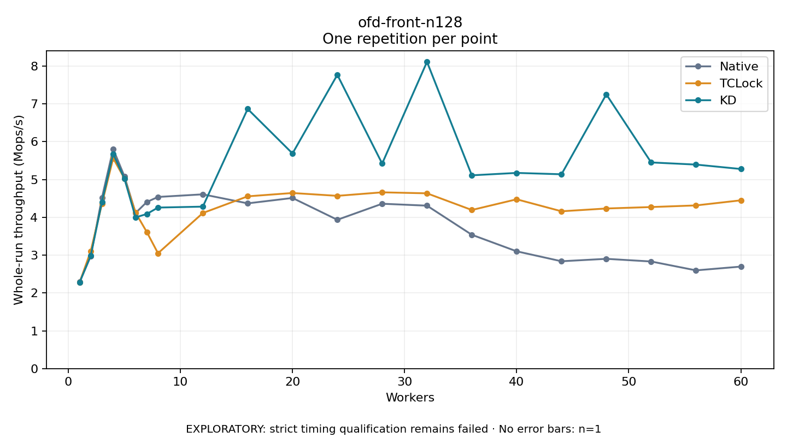

# ofd-front-n128

One timed repetition per point; no repeat variability estimate.
EXPLORATORY: strict timing qualification remains failed. Rates include post-lock work. Failed/unrun cases have no plotted rate.

| Workers | Native Mops/s | TCLock Mops/s | KD Mops/s | KD execution |
| ---: | ---: | ---: | ---: | --- |
| 1 | 2.290 | 2.274 | 2.274 | NO_JIT |
| 2 | 2.975 | 3.108 | 2.988 | NO_JIT |
| 3 | 4.519 | 4.360 | 4.409 | NO_JIT |
| 4 | 5.806 | 5.563 | 5.681 | NO_JIT |
| 5 | 5.088 | 5.029 | 5.027 | NO_JIT |
| 6 | 4.116 | 4.122 | 3.999 | NO_JIT |
| 7 | 4.405 | 3.612 | 4.088 | NO_JIT |
| 8 | 4.539 | 3.050 | 4.259 | NO_JIT |
| 12 | 4.608 | 4.114 | 4.283 | RETURNED_JIT |
| 16 | 4.369 | 4.555 | 6.866 | RETURNED_JIT |
| 20 | 4.512 | 4.643 | 5.689 | RETURNED_JIT |
| 24 | 3.935 | 4.568 | 7.769 | RETURNED_JIT |
| 28 | 4.359 | 4.661 | 5.421 | RETURNED_JIT |
| 32 | 4.309 | 4.635 | 8.112 | RETURNED_JIT |
| 36 | 3.539 | 4.194 | 5.111 | RETURNED_JIT |
| 40 | 3.101 | 4.477 | 5.175 | RETURNED_JIT |
| 44 | 2.838 | 4.160 | 5.139 | RETURNED_JIT |
| 48 | 2.903 | 4.234 | 7.252 | RETURNED_JIT |
| 52 | 2.832 | 4.272 | 5.452 | RETURNED_JIT |
| 56 | 2.598 | 4.315 | 5.395 | RETURNED_JIT |
| 60 | 2.697 | 4.450 | 5.278 | RETURNED_JIT |

[Full receipt table](table.csv)

