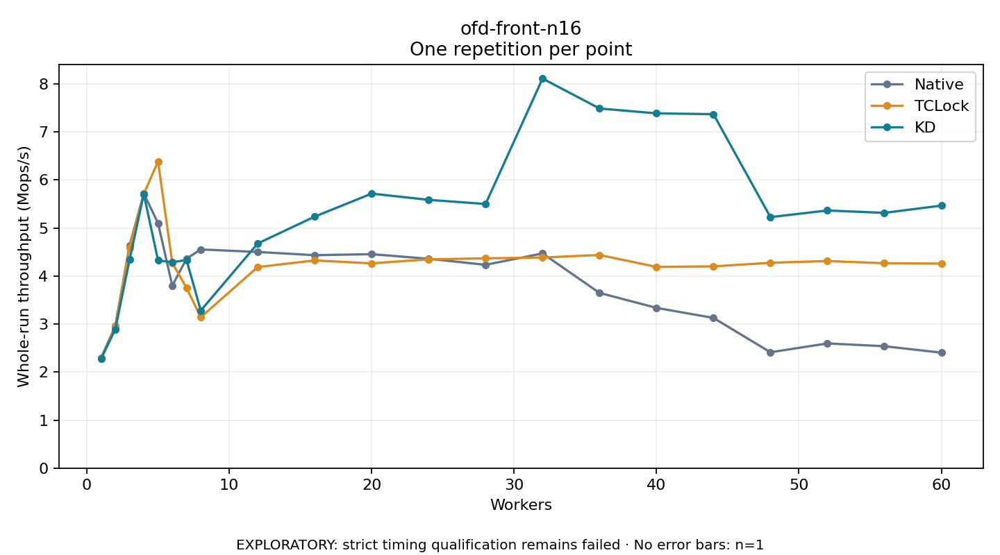

# ofd-front-n16

One timed repetition per point; no repeat variability estimate.
EXPLORATORY: strict timing qualification remains failed. Rates include post-lock work. Failed/unrun cases have no plotted rate.

| Workers | Native Mops/s | TCLock Mops/s | KD Mops/s | KD execution |
| ---: | ---: | ---: | ---: | --- |
| 1 | 2.292 | 2.276 | 2.276 | NO_JIT |
| 2 | 2.964 | 2.938 | 2.892 | NO_JIT |
| 3 | 4.637 | 4.594 | 4.338 | NO_JIT |
| 4 | 5.717 | 5.711 | 5.706 | NO_JIT |
| 5 | 5.102 | 6.387 | 4.327 | NO_JIT |
| 6 | 3.799 | 4.274 | 4.286 | NO_JIT |
| 7 | 4.360 | 3.752 | 4.335 | NO_JIT |
| 8 | 4.554 | 3.142 | 3.281 | RETURNED_JIT |
| 12 | 4.501 | 4.187 | 4.678 | RETURNED_JIT |
| 16 | 4.434 | 4.324 | 5.237 | RETURNED_JIT |
| 20 | 4.455 | 4.264 | 5.716 | RETURNED_JIT |
| 24 | 4.359 | 4.347 | 5.587 | RETURNED_JIT |
| 28 | 4.234 | 4.368 | 5.500 | RETURNED_JIT |
| 32 | 4.470 | 4.385 | 8.112 | RETURNED_JIT |
| 36 | 3.648 | 4.438 | 7.489 | RETURNED_JIT |
| 40 | 3.337 | 4.190 | 7.387 | RETURNED_JIT |
| 44 | 3.128 | 4.201 | 7.370 | RETURNED_JIT |
| 48 | 2.412 | 4.276 | 5.227 | RETURNED_JIT |
| 52 | 2.597 | 4.313 | 5.365 | RETURNED_JIT |
| 56 | 2.538 | 4.267 | 5.316 | RETURNED_JIT |
| 60 | 2.405 | 4.258 | 5.466 | RETURNED_JIT |

[Full receipt table](table.csv)

