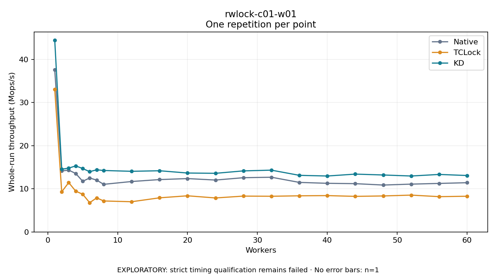

# rwlock-c01-w01

One timed repetition per point; no repeat variability estimate.
EXPLORATORY: strict timing qualification remains failed. Rates include post-lock work. Failed/unrun cases have no plotted rate.

| Workers | Native Mops/s | TCLock Mops/s | KD Mops/s | KD execution |
| ---: | ---: | ---: | ---: | --- |
| 1 | 37.582 | 33.079 | 44.497 | NO_JIT |
| 2 | 14.142 | 9.312 | 14.548 | NO_JIT |
| 3 | 14.343 | 11.449 | 14.803 | NO_JIT |
| 4 | 13.563 | 9.468 | 15.319 | NO_JIT |
| 5 | 11.751 | 8.746 | 14.711 | NO_JIT |
| 6 | 12.518 | 6.787 | 13.977 | NO_JIT |
| 7 | 12.023 | 7.909 | 14.417 | NO_JIT |
| 8 | 11.045 | 7.185 | 14.255 | NO_JIT |
| 12 | 11.698 | 7.009 | 14.065 | NO_JIT |
| 16 | 12.147 | 7.917 | 14.195 | RETURNED_JIT |
| 20 | 12.377 | 8.386 | 13.667 | RETURNED_JIT |
| 24 | 12.039 | 7.886 | 13.600 | RETURNED_JIT |
| 28 | 12.582 | 8.314 | 14.163 | RETURNED_JIT |
| 32 | 12.691 | 8.278 | 14.333 | RETURNED_JIT |
| 36 | 11.491 | 8.383 | 13.130 | RETURNED_JIT |
| 40 | 11.282 | 8.430 | 12.974 | RETURNED_JIT |
| 44 | 11.201 | 8.253 | 13.415 | RETURNED_JIT |
| 48 | 10.879 | 8.350 | 13.212 | RETURNED_JIT |
| 52 | 11.092 | 8.545 | 12.974 | RETURNED_JIT |
| 56 | 11.255 | 8.186 | 13.340 | RETURNED_JIT |
| 60 | 11.423 | 8.282 | 13.090 | RETURNED_JIT |

[Full receipt table](table.csv)

