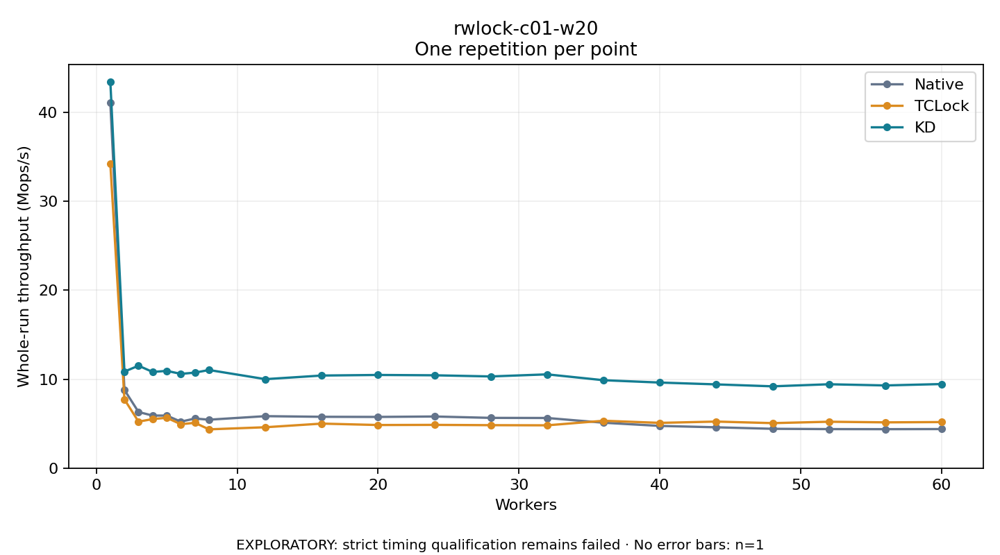

# rwlock-c01-w20

One timed repetition per point; no repeat variability estimate.
EXPLORATORY: strict timing qualification remains failed. Rates include post-lock work. Failed/unrun cases have no plotted rate.

| Workers | Native Mops/s | TCLock Mops/s | KD Mops/s | KD execution |
| ---: | ---: | ---: | ---: | --- |
| 1 | 41.069 | 34.209 | 43.431 | NO_JIT |
| 2 | 8.789 | 7.722 | 10.852 | NO_JIT |
| 3 | 6.309 | 5.226 | 11.517 | NO_JIT |
| 4 | 5.911 | 5.515 | 10.813 | NO_JIT |
| 5 | 5.908 | 5.661 | 10.936 | NO_JIT |
| 6 | 5.225 | 4.934 | 10.598 | NO_JIT |
| 7 | 5.575 | 5.096 | 10.738 | NO_JIT |
| 8 | 5.446 | 4.360 | 11.033 | NO_JIT |
| 12 | 5.842 | 4.596 | 10.003 | RETURNED_JIT |
| 16 | 5.770 | 5.004 | 10.411 | RETURNED_JIT |
| 20 | 5.756 | 4.846 | 10.476 | RETURNED_JIT |
| 24 | 5.804 | 4.862 | 10.438 | RETURNED_JIT |
| 28 | 5.649 | 4.829 | 10.308 | RETURNED_JIT |
| 32 | 5.637 | 4.812 | 10.543 | RETURNED_JIT |
| 36 | 5.105 | 5.325 | 9.884 | RETURNED_JIT |
| 40 | 4.746 | 5.088 | 9.621 | RETURNED_JIT |
| 44 | 4.590 | 5.234 | 9.415 | RETURNED_JIT |
| 48 | 4.421 | 5.059 | 9.196 | NO_JIT |
| 52 | 4.387 | 5.215 | 9.431 | NO_JIT |
| 56 | 4.379 | 5.145 | 9.297 | NO_JIT |
| 60 | 4.392 | 5.179 | 9.454 | NO_JIT |

[Full receipt table](table.csv)

