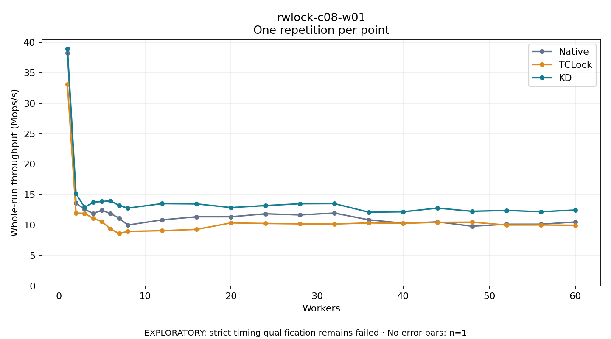

# rwlock-c08-w01

One timed repetition per point; no repeat variability estimate.
EXPLORATORY: strict timing qualification remains failed. Rates include post-lock work. Failed/unrun cases have no plotted rate.

| Workers | Native Mops/s | TCLock Mops/s | KD Mops/s | KD execution |
| ---: | ---: | ---: | ---: | --- |
| 1 | 38.280 | 33.090 | 38.976 | NO_JIT |
| 2 | 13.609 | 11.976 | 15.132 | NO_JIT |
| 3 | 12.562 | 11.915 | 12.923 | NO_JIT |
| 4 | 11.911 | 11.102 | 13.746 | NO_JIT |
| 5 | 12.423 | 10.576 | 13.872 | NO_JIT |
| 6 | 11.888 | 9.360 | 13.982 | NO_JIT |
| 7 | 11.150 | 8.608 | 13.221 | NO_JIT |
| 8 | 9.995 | 8.961 | 12.786 | NO_JIT |
| 12 | 10.856 | 9.078 | 13.522 | NO_JIT |
| 16 | 11.364 | 9.292 | 13.478 | RETURNED_JIT |
| 20 | 11.363 | 10.356 | 12.875 | RETURNED_JIT |
| 24 | 11.850 | 10.257 | 13.200 | RETURNED_JIT |
| 28 | 11.667 | 10.192 | 13.503 | RETURNED_JIT |
| 32 | 11.971 | 10.159 | 13.527 | RETURNED_JIT |
| 36 | 10.865 | 10.355 | 12.107 | RETURNED_JIT |
| 40 | 10.308 | 10.280 | 12.179 | RETURNED_JIT |
| 44 | 10.518 | 10.447 | 12.787 | RETURNED_JIT |
| 48 | 9.808 | 10.475 | 12.258 | RETURNED_JIT |
| 52 | 10.135 | 10.005 | 12.401 | RETURNED_JIT |
| 56 | 10.140 | 10.013 | 12.185 | RETURNED_JIT |
| 60 | 10.503 | 9.962 | 12.471 | RETURNED_JIT |

[Full receipt table](table.csv)

