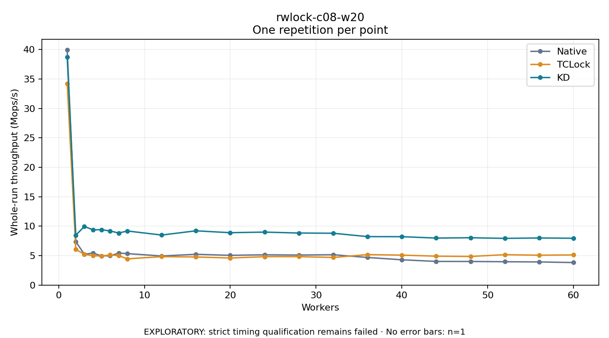

# rwlock-c08-w20

One timed repetition per point; no repeat variability estimate.
EXPLORATORY: strict timing qualification remains failed. Rates include post-lock work. Failed/unrun cases have no plotted rate.

| Workers | Native Mops/s | TCLock Mops/s | KD Mops/s | KD execution |
| ---: | ---: | ---: | ---: | --- |
| 1 | 39.927 | 34.212 | 38.714 | NO_JIT |
| 2 | 7.369 | 6.069 | 8.479 | NO_JIT |
| 3 | 5.238 | 5.224 | 9.950 | NO_JIT |
| 4 | 5.441 | 4.992 | 9.387 | NO_JIT |
| 5 | 4.956 | 4.931 | 9.391 | NO_JIT |
| 6 | 4.968 | 5.118 | 9.195 | NO_JIT |
| 7 | 5.431 | 4.993 | 8.838 | NO_JIT |
| 8 | 5.346 | 4.455 | 9.187 | NO_JIT |
| 12 | 4.941 | 4.829 | 8.497 | RETURNED_JIT |
| 16 | 5.227 | 4.772 | 9.214 | RETURNED_JIT |
| 20 | 5.049 | 4.600 | 8.896 | RETURNED_JIT |
| 24 | 5.143 | 4.823 | 8.996 | RETURNED_JIT |
| 28 | 5.099 | 4.829 | 8.838 | RETURNED_JIT |
| 32 | 5.153 | 4.695 | 8.800 | RETURNED_JIT |
| 36 | 4.688 | 5.174 | 8.230 | RETURNED_JIT |
| 40 | 4.295 | 5.086 | 8.218 | RETURNED_JIT |
| 44 | 4.020 | 4.910 | 7.983 | RETURNED_JIT |
| 48 | 4.010 | 4.862 | 8.040 | RETURNED_JIT |
| 52 | 3.966 | 5.162 | 7.931 | RETURNED_JIT |
| 56 | 3.932 | 5.069 | 8.002 | RETURNED_JIT |
| 60 | 3.823 | 5.123 | 7.949 | RETURNED_JIT |

[Full receipt table](table.csv)

