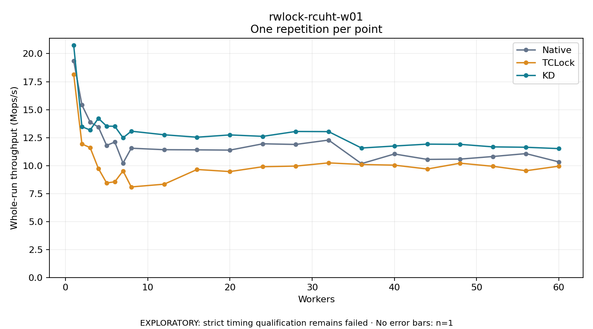

# rwlock-rcuht-w01

One timed repetition per point; no repeat variability estimate.
EXPLORATORY: strict timing qualification remains failed. Rates include post-lock work. Failed/unrun cases have no plotted rate.

| Workers | Native Mops/s | TCLock Mops/s | KD Mops/s | KD execution |
| ---: | ---: | ---: | ---: | --- |
| 1 | 19.370 | 18.155 | 20.745 | NO_JIT |
| 2 | 15.417 | 11.932 | 13.477 | NO_JIT |
| 3 | 13.890 | 11.603 | 13.176 | NO_JIT |
| 4 | 13.444 | 9.744 | 14.225 | NO_JIT |
| 5 | 11.804 | 8.450 | 13.525 | NO_JIT |
| 6 | 12.100 | 8.552 | 13.511 | NO_JIT |
| 7 | 10.225 | 9.524 | 12.480 | NO_JIT |
| 8 | 11.552 | 8.093 | 13.073 | NO_JIT |
| 12 | 11.419 | 8.337 | 12.752 | NO_JIT |
| 16 | 11.405 | 9.651 | 12.536 | NO_JIT |
| 20 | 11.382 | 9.465 | 12.740 | RETURNED_JIT |
| 24 | 11.947 | 9.899 | 12.611 | RETURNED_JIT |
| 28 | 11.889 | 9.954 | 13.048 | RETURNED_JIT |
| 32 | 12.279 | 10.241 | 13.034 | RETURNED_JIT |
| 36 | 10.173 | 10.097 | 11.569 | RETURNED_JIT |
| 40 | 11.036 | 10.039 | 11.748 | RETURNED_JIT |
| 44 | 10.552 | 9.694 | 11.916 | RETURNED_JIT |
| 48 | 10.580 | 10.213 | 11.898 | RETURNED_JIT |
| 52 | 10.811 | 9.935 | 11.671 | RETURNED_JIT |
| 56 | 11.070 | 9.540 | 11.636 | RETURNED_JIT |
| 60 | 10.328 | 9.948 | 11.517 | RETURNED_JIT |

[Full receipt table](table.csv)

