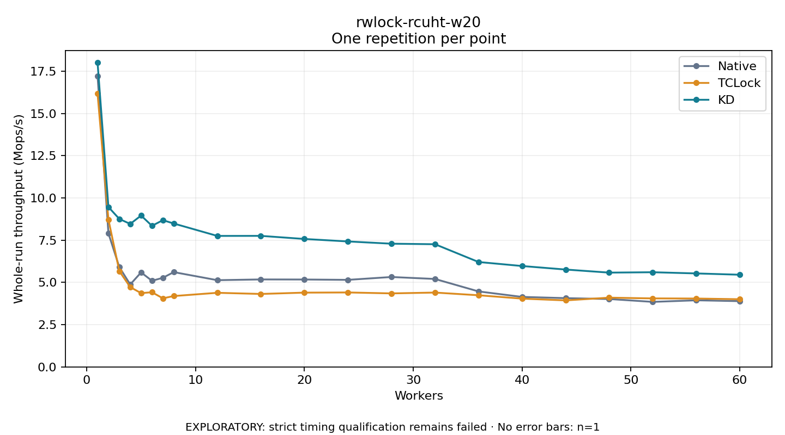

# rwlock-rcuht-w20

One timed repetition per point; no repeat variability estimate.
EXPLORATORY: strict timing qualification remains failed. Rates include post-lock work. Failed/unrun cases have no plotted rate.

| Workers | Native Mops/s | TCLock Mops/s | KD Mops/s | KD execution |
| ---: | ---: | ---: | ---: | --- |
| 1 | 17.223 | 16.168 | 18.016 | NO_JIT |
| 2 | 7.903 | 8.720 | 9.464 | NO_JIT |
| 3 | 5.908 | 5.668 | 8.759 | NO_JIT |
| 4 | 4.879 | 4.725 | 8.463 | NO_JIT |
| 5 | 5.592 | 4.366 | 8.959 | NO_JIT |
| 6 | 5.098 | 4.420 | 8.350 | NO_JIT |
| 7 | 5.275 | 4.059 | 8.685 | NO_JIT |
| 8 | 5.610 | 4.194 | 8.487 | NO_JIT |
| 12 | 5.133 | 4.386 | 7.753 | RETURNED_JIT |
| 16 | 5.177 | 4.318 | 7.756 | RETURNED_JIT |
| 20 | 5.173 | 4.396 | 7.573 | RETURNED_JIT |
| 24 | 5.152 | 4.406 | 7.426 | RETURNED_JIT |
| 28 | 5.321 | 4.351 | 7.293 | RETURNED_JIT |
| 32 | 5.205 | 4.400 | 7.261 | RETURNED_JIT |
| 36 | 4.468 | 4.240 | 6.209 | RETURNED_JIT |
| 40 | 4.143 | 4.041 | 5.971 | RETURNED_JIT |
| 44 | 4.071 | 3.937 | 5.763 | RETURNED_JIT |
| 48 | 4.017 | 4.098 | 5.581 | RETURNED_JIT |
| 52 | 3.849 | 4.054 | 5.604 | RETURNED_JIT |
| 56 | 3.942 | 4.047 | 5.533 | RETURNED_JIT |
| 60 | 3.891 | 4.005 | 5.456 | RETURNED_JIT |

[Full receipt table](table.csv)

