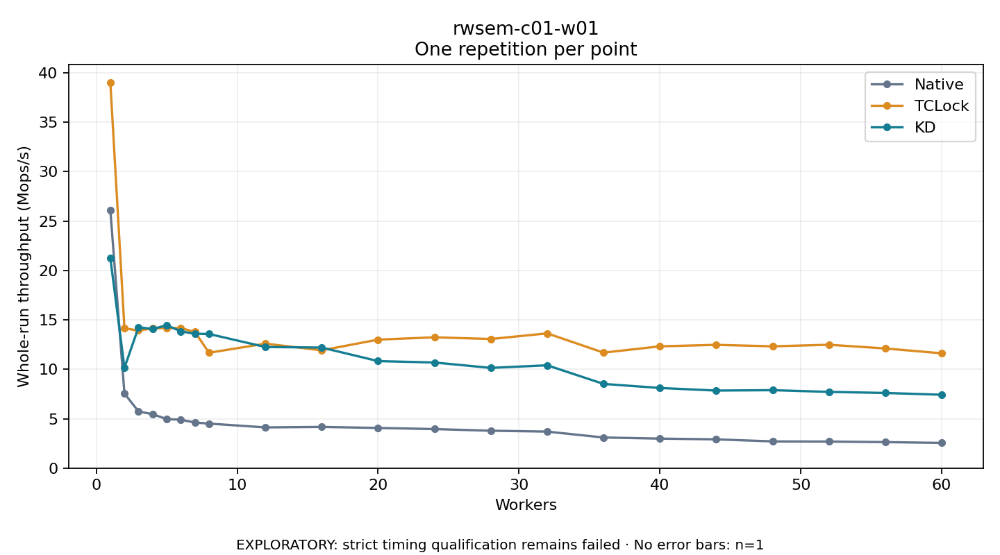

# rwsem-c01-w01

One timed repetition per point; no repeat variability estimate.
EXPLORATORY: strict timing qualification remains failed. Rates include post-lock work. Failed/unrun cases have no plotted rate.

| Workers | Native Mops/s | TCLock Mops/s | KD Mops/s | KD execution |
| ---: | ---: | ---: | ---: | --- |
| 1 | 26.072 | 39.002 | 21.238 | NO_JIT |
| 2 | 7.550 | 14.140 | 10.149 | NO_JIT |
| 3 | 5.731 | 13.914 | 14.250 | NO_JIT |
| 4 | 5.456 | 14.136 | 14.076 | NO_JIT |
| 5 | 4.959 | 14.183 | 14.443 | NO_JIT |
| 6 | 4.894 | 14.165 | 13.841 | NO_JIT |
| 7 | 4.611 | 13.775 | 13.584 | NO_JIT |
| 8 | 4.503 | 11.668 | 13.570 | NO_JIT |
| 12 | 4.118 | 12.590 | 12.252 | NO_JIT |
| 16 | 4.169 | 11.915 | 12.193 | NO_JIT |
| 20 | 4.062 | 12.997 | 10.826 | NO_JIT |
| 24 | 3.949 | 13.230 | 10.682 | NO_JIT |
| 28 | 3.782 | 13.060 | 10.138 | NO_JIT |
| 32 | 3.693 | 13.629 | 10.401 | NO_JIT |
| 36 | 3.097 | 11.681 | 8.517 | NO_JIT |
| 40 | 2.984 | 12.317 | 8.106 | NO_JIT |
| 44 | 2.909 | 12.469 | 7.845 | NO_JIT |
| 48 | 2.701 | 12.320 | 7.883 | NO_JIT |
| 52 | 2.686 | 12.479 | 7.712 | NO_JIT |
| 56 | 2.630 | 12.102 | 7.600 | NO_JIT |
| 60 | 2.547 | 11.612 | 7.424 | NO_JIT |

[Full receipt table](table.csv)

