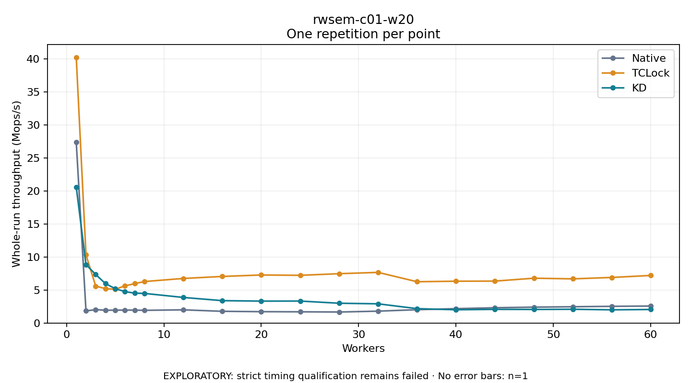

# rwsem-c01-w20

One timed repetition per point; no repeat variability estimate.
EXPLORATORY: strict timing qualification remains failed. Rates include post-lock work. Failed/unrun cases have no plotted rate.

| Workers | Native Mops/s | TCLock Mops/s | KD Mops/s | KD execution |
| ---: | ---: | ---: | ---: | --- |
| 1 | 27.406 | 40.265 | 20.611 | NO_JIT |
| 2 | 1.838 | 10.322 | 8.866 | NO_JIT |
| 3 | 2.033 | 5.591 | 7.351 | NO_JIT |
| 4 | 1.939 | 5.213 | 5.975 | NO_JIT |
| 5 | 1.953 | 5.113 | 5.205 | NO_JIT |
| 6 | 1.959 | 5.629 | 4.768 | NO_JIT |
| 7 | 1.957 | 5.968 | 4.526 | NO_JIT |
| 8 | 1.926 | 6.287 | 4.490 | NO_JIT |
| 12 | 2.001 | 6.755 | 3.878 | NO_JIT |
| 16 | 1.777 | 7.057 | 3.392 | NO_JIT |
| 20 | 1.723 | 7.281 | 3.321 | NO_JIT |
| 24 | 1.702 | 7.230 | 3.329 | NO_JIT |
| 28 | 1.668 | 7.477 | 2.999 | NO_JIT |
| 32 | 1.801 | 7.675 | 2.911 | NO_JIT |
| 36 | 2.021 | 6.257 | 2.182 | RETURNED_JIT |
| 40 | 2.180 | 6.338 | 2.012 | RETURNED_JIT |
| 44 | 2.318 | 6.353 | 2.074 | RETURNED_JIT |
| 48 | 2.408 | 6.793 | 2.058 | RETURNED_JIT |
| 52 | 2.470 | 6.694 | 2.087 | RETURNED_JIT |
| 56 | 2.532 | 6.906 | 2.002 | RETURNED_JIT |
| 60 | 2.576 | 7.210 | 2.054 | RETURNED_JIT |

[Full receipt table](table.csv)

