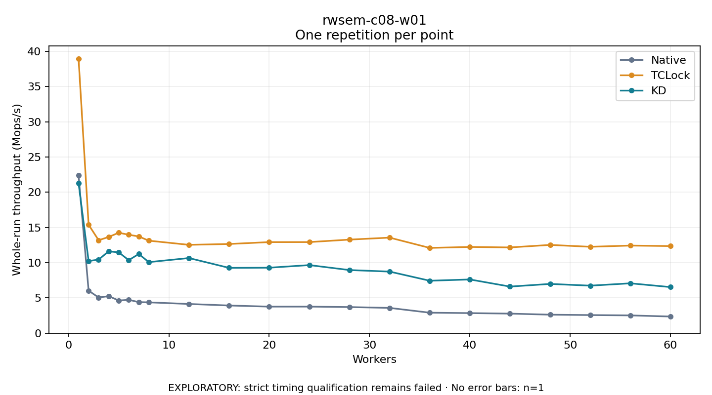

# rwsem-c08-w01

One timed repetition per point; no repeat variability estimate.
EXPLORATORY: strict timing qualification remains failed. Rates include post-lock work. Failed/unrun cases have no plotted rate.

| Workers | Native Mops/s | TCLock Mops/s | KD Mops/s | KD execution |
| ---: | ---: | ---: | ---: | --- |
| 1 | 22.388 | 38.943 | 21.265 | NO_JIT |
| 2 | 6.032 | 15.391 | 10.238 | NO_JIT |
| 3 | 5.064 | 13.193 | 10.444 | NO_JIT |
| 4 | 5.255 | 13.653 | 11.617 | NO_JIT |
| 5 | 4.636 | 14.254 | 11.471 | NO_JIT |
| 6 | 4.732 | 13.971 | 10.365 | NO_JIT |
| 7 | 4.407 | 13.728 | 11.235 | NO_JIT |
| 8 | 4.372 | 13.130 | 10.087 | NO_JIT |
| 12 | 4.143 | 12.539 | 10.662 | NO_JIT |
| 16 | 3.926 | 12.657 | 9.269 | NO_JIT |
| 20 | 3.766 | 12.926 | 9.293 | NO_JIT |
| 24 | 3.768 | 12.929 | 9.661 | NO_JIT |
| 28 | 3.704 | 13.280 | 8.958 | NO_JIT |
| 32 | 3.586 | 13.561 | 8.740 | NO_JIT |
| 36 | 2.906 | 12.102 | 7.443 | NO_JIT |
| 40 | 2.847 | 12.238 | 7.623 | NO_JIT |
| 44 | 2.775 | 12.169 | 6.612 | NO_JIT |
| 48 | 2.624 | 12.527 | 6.989 | NO_JIT |
| 52 | 2.569 | 12.261 | 6.742 | NO_JIT |
| 56 | 2.522 | 12.434 | 7.075 | NO_JIT |
| 60 | 2.361 | 12.363 | 6.539 | NO_JIT |

[Full receipt table](table.csv)

