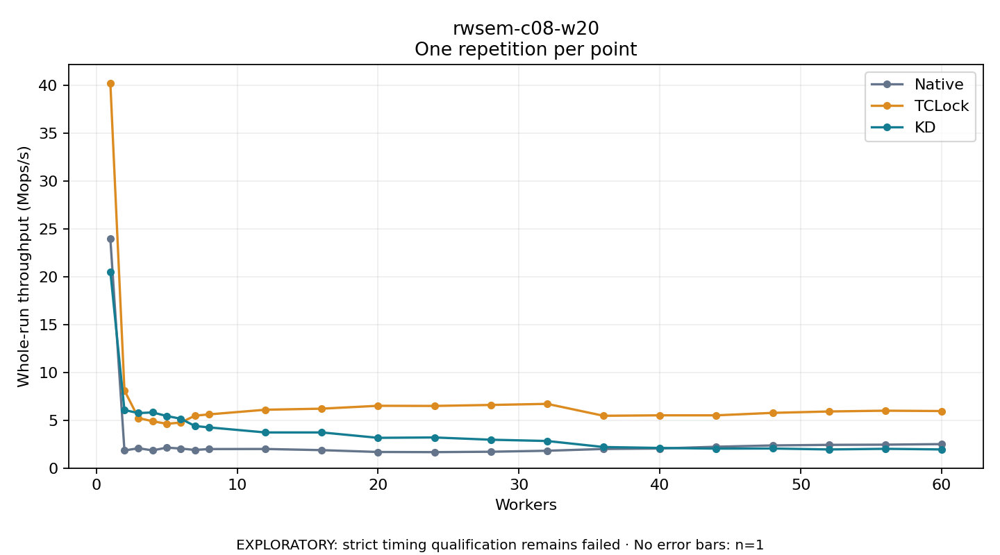

# rwsem-c08-w20

One timed repetition per point; no repeat variability estimate.
EXPLORATORY: strict timing qualification remains failed. Rates include post-lock work. Failed/unrun cases have no plotted rate.

| Workers | Native Mops/s | TCLock Mops/s | KD Mops/s | KD execution |
| ---: | ---: | ---: | ---: | --- |
| 1 | 23.948 | 40.231 | 20.518 | NO_JIT |
| 2 | 1.843 | 8.107 | 6.068 | NO_JIT |
| 3 | 2.076 | 5.222 | 5.748 | NO_JIT |
| 4 | 1.848 | 4.899 | 5.817 | RETURNED_JIT |
| 5 | 2.141 | 4.629 | 5.443 | RETURNED_JIT |
| 6 | 2.042 | 4.760 | 5.157 | RETURNED_JIT |
| 7 | 1.898 | 5.475 | 4.397 | RETURNED_JIT |
| 8 | 1.990 | 5.612 | 4.253 | RETURNED_JIT |
| 12 | 1.999 | 6.097 | 3.726 | RETURNED_JIT |
| 16 | 1.878 | 6.210 | 3.727 | RETURNED_JIT |
| 20 | 1.685 | 6.510 | 3.164 | RETURNED_JIT |
| 24 | 1.669 | 6.496 | 3.202 | RETURNED_JIT |
| 28 | 1.711 | 6.598 | 2.967 | RETURNED_JIT |
| 32 | 1.814 | 6.711 | 2.833 | RETURNED_JIT |
| 36 | 1.999 | 5.467 | 2.203 | RETURNED_JIT |
| 40 | 2.047 | 5.514 | 2.107 | RETURNED_JIT |
| 44 | 2.233 | 5.513 | 2.037 | RETURNED_JIT |
| 48 | 2.370 | 5.771 | 2.048 | RETURNED_JIT |
| 52 | 2.430 | 5.917 | 1.949 | RETURNED_JIT |
| 56 | 2.451 | 5.999 | 2.016 | RETURNED_JIT |
| 60 | 2.507 | 5.961 | 1.950 | RETURNED_JIT |

[Full receipt table](table.csv)

