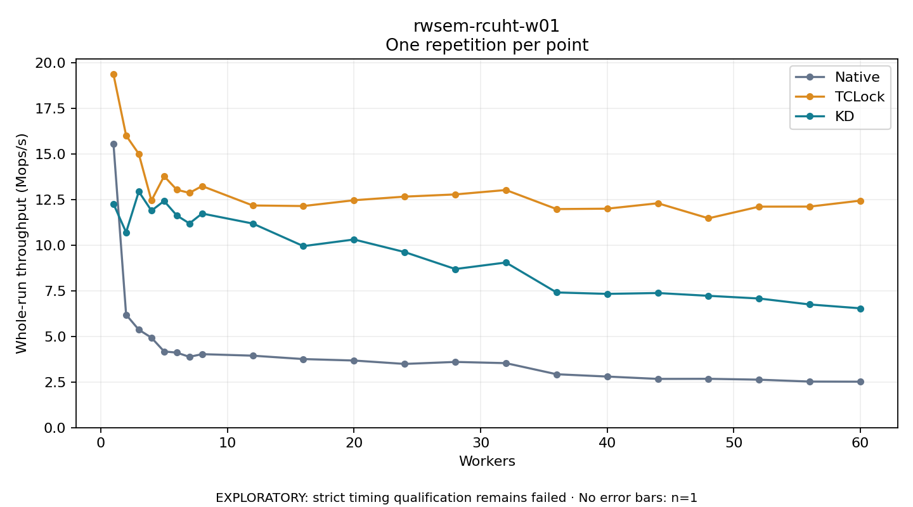

# rwsem-rcuht-w01

One timed repetition per point; no repeat variability estimate.
EXPLORATORY: strict timing qualification remains failed. Rates include post-lock work. Failed/unrun cases have no plotted rate.

| Workers | Native Mops/s | TCLock Mops/s | KD Mops/s | KD execution |
| ---: | ---: | ---: | ---: | --- |
| 1 | 15.576 | 19.376 | 12.271 | NO_JIT |
| 2 | 6.194 | 16.017 | 10.711 | NO_JIT |
| 3 | 5.370 | 15.014 | 12.947 | NO_JIT |
| 4 | 4.934 | 12.452 | 11.897 | NO_JIT |
| 5 | 4.178 | 13.790 | 12.429 | NO_JIT |
| 6 | 4.113 | 13.047 | 11.636 | NO_JIT |
| 7 | 3.882 | 12.872 | 11.198 | NO_JIT |
| 8 | 4.030 | 13.248 | 11.741 | NO_JIT |
| 12 | 3.946 | 12.183 | 11.192 | NO_JIT |
| 16 | 3.760 | 12.152 | 9.954 | NO_JIT |
| 20 | 3.679 | 12.470 | 10.318 | NO_JIT |
| 24 | 3.493 | 12.668 | 9.628 | NO_JIT |
| 28 | 3.603 | 12.789 | 8.697 | NO_JIT |
| 32 | 3.536 | 13.031 | 9.055 | NO_JIT |
| 36 | 2.928 | 11.985 | 7.412 | NO_JIT |
| 40 | 2.801 | 12.007 | 7.335 | NO_JIT |
| 44 | 2.672 | 12.304 | 7.382 | NO_JIT |
| 48 | 2.678 | 11.479 | 7.228 | NO_JIT |
| 52 | 2.630 | 12.119 | 7.081 | NO_JIT |
| 56 | 2.526 | 12.122 | 6.754 | NO_JIT |
| 60 | 2.520 | 12.449 | 6.543 | NO_JIT |

[Full receipt table](table.csv)

