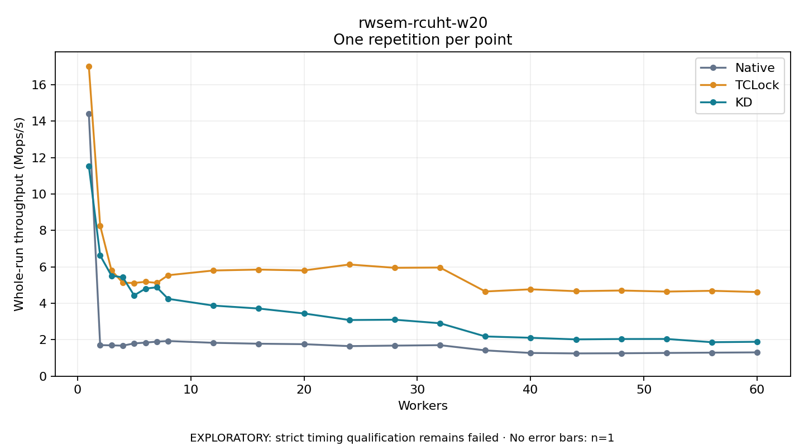

# rwsem-rcuht-w20

One timed repetition per point; no repeat variability estimate.
EXPLORATORY: strict timing qualification remains failed. Rates include post-lock work. Failed/unrun cases have no plotted rate.

| Workers | Native Mops/s | TCLock Mops/s | KD Mops/s | KD execution |
| ---: | ---: | ---: | ---: | --- |
| 1 | 14.405 | 17.015 | 11.531 | NO_JIT |
| 2 | 1.706 | 8.263 | 6.628 | NO_JIT |
| 3 | 1.692 | 5.807 | 5.516 | NO_JIT |
| 4 | 1.677 | 5.130 | 5.427 | NO_JIT |
| 5 | 1.799 | 5.117 | 4.436 | NO_JIT |
| 6 | 1.843 | 5.181 | 4.808 | NO_JIT |
| 7 | 1.896 | 5.121 | 4.879 | NO_JIT |
| 8 | 1.930 | 5.542 | 4.246 | NO_JIT |
| 12 | 1.831 | 5.801 | 3.875 | NO_JIT |
| 16 | 1.782 | 5.852 | 3.713 | NO_JIT |
| 20 | 1.757 | 5.804 | 3.442 | RETURNED_JIT |
| 24 | 1.650 | 6.131 | 3.083 | RETURNED_JIT |
| 28 | 1.678 | 5.950 | 3.100 | RETURNED_JIT |
| 32 | 1.702 | 5.964 | 2.906 | RETURNED_JIT |
| 36 | 1.416 | 4.650 | 2.181 | RETURNED_JIT |
| 40 | 1.274 | 4.769 | 2.108 | RETURNED_JIT |
| 44 | 1.250 | 4.665 | 2.020 | RETURNED_JIT |
| 48 | 1.258 | 4.703 | 2.040 | RETURNED_JIT |
| 52 | 1.275 | 4.644 | 2.043 | RETURNED_JIT |
| 56 | 1.292 | 4.687 | 1.865 | RETURNED_JIT |
| 60 | 1.306 | 4.619 | 1.888 | RETURNED_JIT |

[Full receipt table](table.csv)

