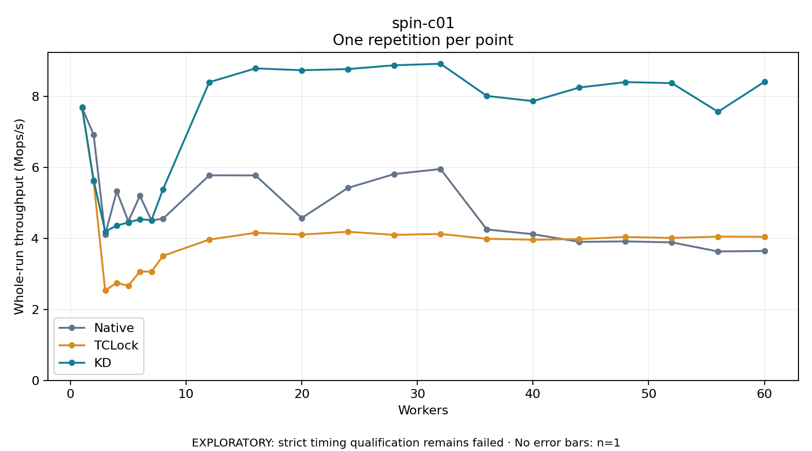

# spin-c01

One timed repetition per point; no repeat variability estimate.
EXPLORATORY: strict timing qualification remains failed. Rates include post-lock work. Failed/unrun cases have no plotted rate.

| Workers | Native Mops/s | TCLock Mops/s | KD Mops/s | KD execution |
| ---: | ---: | ---: | ---: | --- |
| 1 | 7.688 | 7.697 | 7.701 | NO_JIT |
| 2 | 6.927 | 5.602 | 5.643 | NO_JIT |
| 3 | 4.114 | 2.535 | 4.197 | NO_JIT |
| 4 | 5.332 | 2.752 | 4.367 | NO_JIT |
| 5 | 4.485 | 2.666 | 4.451 | NO_JIT |
| 6 | 5.205 | 3.070 | 4.546 | NO_JIT |
| 7 | 4.510 | 3.066 | 4.515 | NO_JIT |
| 8 | 4.559 | 3.512 | 5.387 | RETURNED_JIT |
| 12 | 5.782 | 3.970 | 8.407 | RETURNED_JIT |
| 16 | 5.779 | 4.160 | 8.797 | RETURNED_JIT |
| 20 | 4.579 | 4.111 | 8.744 | RETURNED_JIT |
| 24 | 5.428 | 4.190 | 8.777 | RETURNED_JIT |
| 28 | 5.817 | 4.103 | 8.884 | RETURNED_JIT |
| 32 | 5.959 | 4.129 | 8.927 | RETURNED_JIT |
| 36 | 4.256 | 3.993 | 8.019 | RETURNED_JIT |
| 40 | 4.122 | 3.965 | 7.874 | RETURNED_JIT |
| 44 | 3.905 | 3.986 | 8.258 | RETURNED_JIT |
| 48 | 3.920 | 4.043 | 8.410 | RETURNED_JIT |
| 52 | 3.890 | 4.016 | 8.381 | RETURNED_JIT |
| 56 | 3.635 | 4.054 | 7.573 | RETURNED_JIT |
| 60 | 3.649 | 4.048 | 8.418 | RETURNED_JIT |

[Full receipt table](table.csv)

