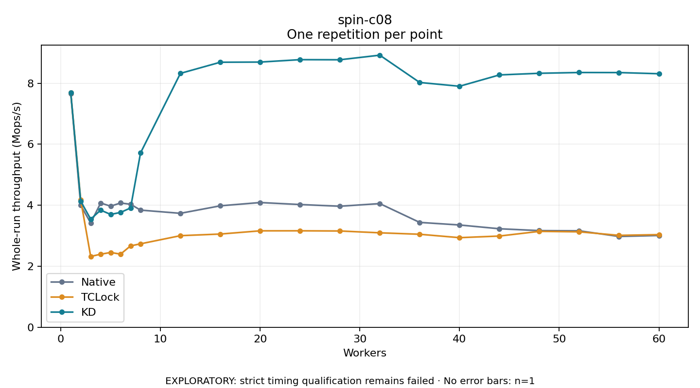

# spin-c08

One timed repetition per point; no repeat variability estimate.
EXPLORATORY: strict timing qualification remains failed. Rates include post-lock work. Failed/unrun cases have no plotted rate.

| Workers | Native Mops/s | TCLock Mops/s | KD Mops/s | KD execution |
| ---: | ---: | ---: | ---: | --- |
| 1 | 7.665 | 7.687 | 7.688 | NO_JIT |
| 2 | 3.995 | 4.170 | 4.131 | NO_JIT |
| 3 | 3.419 | 2.320 | 3.543 | NO_JIT |
| 4 | 4.073 | 2.395 | 3.840 | NO_JIT |
| 5 | 3.969 | 2.451 | 3.698 | NO_JIT |
| 6 | 4.074 | 2.398 | 3.764 | NO_JIT |
| 7 | 4.032 | 2.667 | 3.910 | NO_JIT |
| 8 | 3.840 | 2.735 | 5.714 | RETURNED_JIT |
| 12 | 3.735 | 3.002 | 8.322 | RETURNED_JIT |
| 16 | 3.981 | 3.055 | 8.687 | RETURNED_JIT |
| 20 | 4.088 | 3.161 | 8.692 | RETURNED_JIT |
| 24 | 4.023 | 3.162 | 8.772 | RETURNED_JIT |
| 28 | 3.967 | 3.156 | 8.768 | RETURNED_JIT |
| 32 | 4.053 | 3.096 | 8.918 | RETURNED_JIT |
| 36 | 3.437 | 3.048 | 8.024 | RETURNED_JIT |
| 40 | 3.352 | 2.937 | 7.900 | RETURNED_JIT |
| 44 | 3.229 | 2.990 | 8.271 | RETURNED_JIT |
| 48 | 3.168 | 3.143 | 8.325 | RETURNED_JIT |
| 52 | 3.162 | 3.128 | 8.350 | RETURNED_JIT |
| 56 | 2.976 | 3.013 | 8.348 | RETURNED_JIT |
| 60 | 3.008 | 3.036 | 8.310 | RETURNED_JIT |

[Full receipt table](table.csv)

