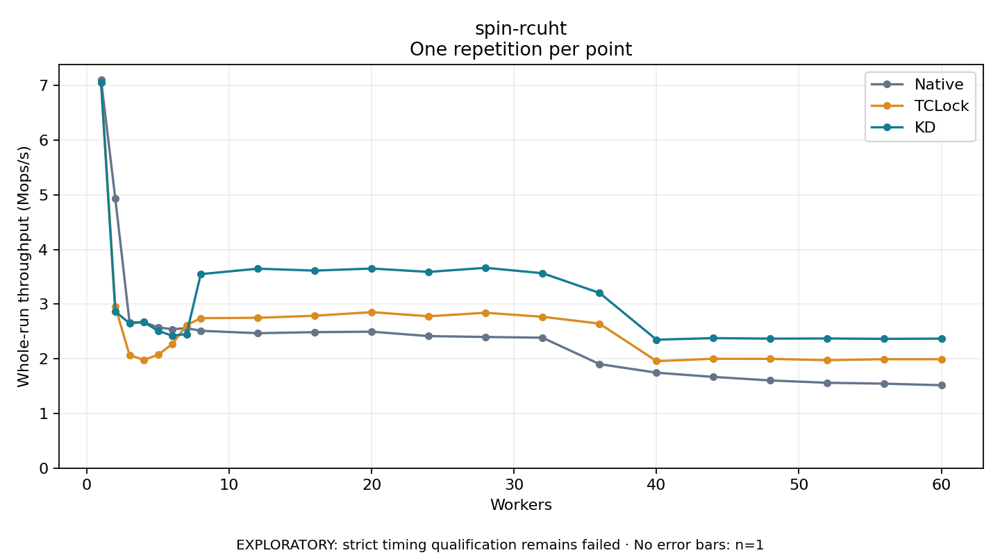

# spin-rcuht

One timed repetition per point; no repeat variability estimate.
EXPLORATORY: strict timing qualification remains failed. Rates include post-lock work. Failed/unrun cases have no plotted rate.

| Workers | Native Mops/s | TCLock Mops/s | KD Mops/s | KD execution |
| ---: | ---: | ---: | ---: | --- |
| 1 | 7.107 | 7.059 | 7.050 | NO_JIT |
| 2 | 4.934 | 2.953 | 2.865 | NO_JIT |
| 3 | 2.666 | 2.068 | 2.652 | NO_JIT |
| 4 | 2.671 | 1.981 | 2.674 | NO_JIT |
| 5 | 2.576 | 2.073 | 2.511 | NO_JIT |
| 6 | 2.542 | 2.270 | 2.425 | NO_JIT |
| 7 | 2.563 | 2.615 | 2.453 | NO_JIT |
| 8 | 2.513 | 2.744 | 3.550 | RETURNED_JIT |
| 12 | 2.469 | 2.751 | 3.650 | RETURNED_JIT |
| 16 | 2.488 | 2.789 | 3.615 | RETURNED_JIT |
| 20 | 2.497 | 2.855 | 3.653 | RETURNED_JIT |
| 24 | 2.416 | 2.779 | 3.591 | RETURNED_JIT |
| 28 | 2.400 | 2.843 | 3.666 | RETURNED_JIT |
| 32 | 2.387 | 2.769 | 3.567 | RETURNED_JIT |
| 36 | 1.903 | 2.644 | 3.206 | RETURNED_JIT |
| 40 | 1.747 | 1.959 | 2.351 | RETURNED_JIT |
| 44 | 1.669 | 2.001 | 2.379 | RETURNED_JIT |
| 48 | 1.604 | 1.999 | 2.370 | RETURNED_JIT |
| 52 | 1.562 | 1.975 | 2.373 | RETURNED_JIT |
| 56 | 1.546 | 1.994 | 2.366 | RETURNED_JIT |
| 60 | 1.517 | 1.992 | 2.370 | RETURNED_JIT |

[Full receipt table](table.csv)

