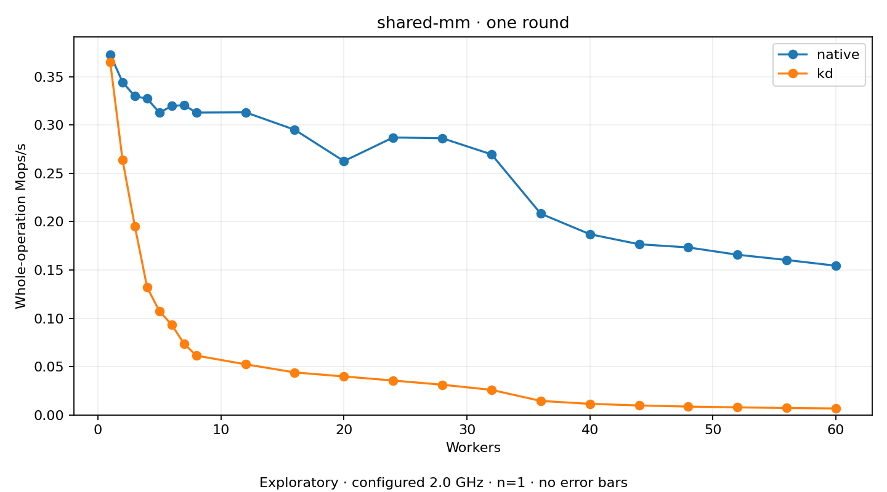

# shared-mm

One two-second plain round per coordinate. Host policy: 2.0 GHz; timing remains exploratory.
No repeat-based variance estimate. Missing or failed points have no throughput value.

Actual shared-mm mmap/munmap pairs with the selected built-in local backend. Native MM bodies execute on the original task; no body delegation.

| Workers | native Mops/s | kd Mops/s |
| ---: | ---: | ---: |
| 1 | 0.373048 | 0.365013 |
| 2 | 0.344394 | 0.264006 |
| 3 | 0.329823 | 0.195450 |
| 4 | 0.327260 | 0.132070 |
| 5 | 0.312809 | 0.107382 |
| 6 | 0.319714 | 0.093315 |
| 7 | 0.320585 | 0.073765 |
| 8 | 0.312908 | 0.061433 |
| 12 | 0.313163 | 0.052442 |
| 16 | 0.295099 | 0.044061 |
| 20 | 0.262648 | 0.039831 |
| 24 | 0.287121 | 0.035654 |
| 28 | 0.286341 | 0.031295 |
| 32 | 0.269637 | 0.025969 |
| 36 | 0.208285 | 0.014547 |
| 40 | 0.187029 | 0.011522 |
| 44 | 0.176646 | 0.009850 |
| 48 | 0.173358 | 0.008679 |
| 52 | 0.165806 | 0.007876 |
| 56 | 0.160355 | 0.007196 |
| 60 | 0.154433 | 0.006731 |

[Full receipt table](table.csv)

