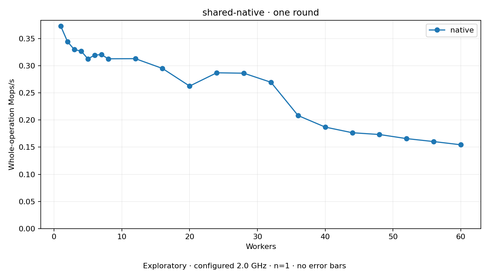

# shared-native

One two-second plain round per coordinate. Host policy: 2.0 GHz; timing remains exploratory.
No repeat-based variance estimate. Missing or failed points have no throughput value.

Actual shared-mm mmap/munmap pairs with the selected built-in local backend. Native MM bodies execute on the original task; no body delegation.

| Workers | native Mops/s |
| ---: | ---: |
| 1 | 0.373048 |
| 2 | 0.344394 |
| 3 | 0.329823 |
| 4 | 0.327260 |
| 5 | 0.312809 |
| 6 | 0.319714 |
| 7 | 0.320585 |
| 8 | 0.312908 |
| 12 | 0.313163 |
| 16 | 0.295099 |
| 20 | 0.262648 |
| 24 | 0.287121 |
| 28 | 0.286341 |
| 32 | 0.269637 |
| 36 | 0.208285 |
| 40 | 0.187029 |
| 44 | 0.176646 |
| 48 | 0.173358 |
| 52 | 0.165806 |
| 56 | 0.160355 |
| 60 | 0.154433 |

[Full receipt table](table.csv)

