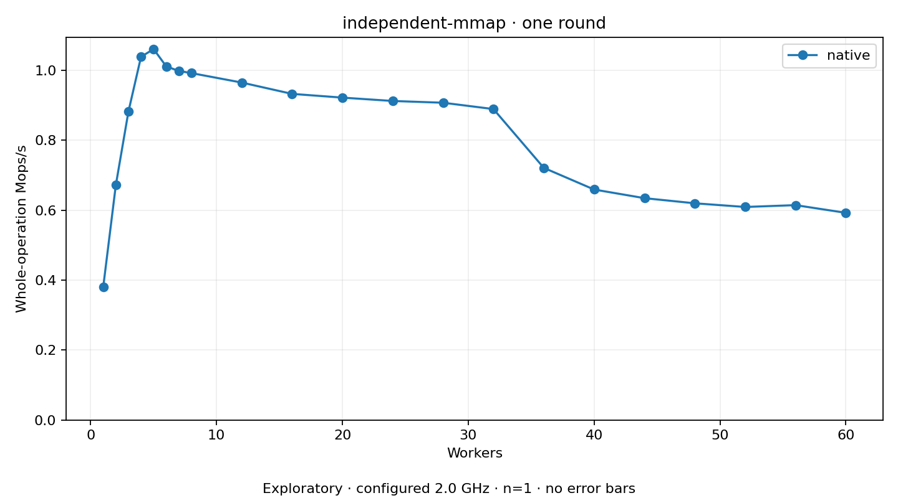

# independent-mmap

One two-second plain round per coordinate. Host policy: 2.0 GHz; timing remains exploratory.
No repeat-based variance estimate. Missing or failed points have no throughput value.

Independent native mm mappings; untouched mmap/munmap pairs. No KD/TCLock mmap arm.

| Workers | native Mops/s |
| ---: | ---: |
| 1 | 0.380951 |
| 2 | 0.671745 |
| 3 | 0.881509 |
| 4 | 1.038067 |
| 5 | 1.060224 |
| 6 | 1.010905 |
| 7 | 0.997610 |
| 8 | 0.991534 |
| 12 | 0.964507 |
| 16 | 0.932144 |
| 20 | 0.921463 |
| 24 | 0.911859 |
| 28 | 0.906819 |
| 32 | 0.888748 |
| 36 | 0.720702 |
| 40 | 0.658748 |
| 44 | 0.634099 |
| 48 | 0.619424 |
| 52 | 0.608927 |
| 56 | 0.614178 |
| 60 | 0.592175 |

[Full receipt table](table.csv)

