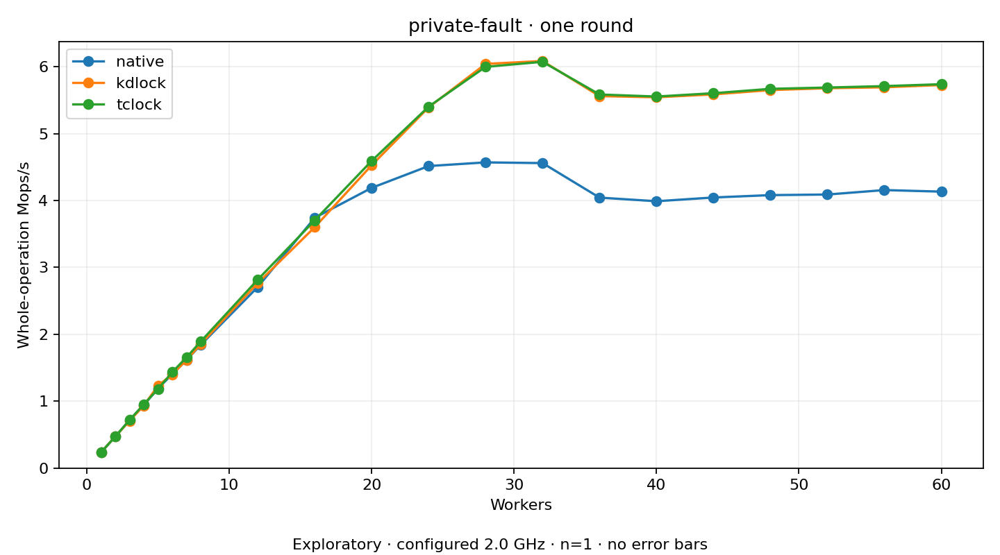

# private-fault

One two-second plain round per coordinate. Host policy: 2.0 GHz; timing remains exploratory.
No repeat-based variance estimate. Missing or failed points have no throughput value.

MADV_DONTNEED plus checked read; Native/KD/TCLock protect private backing state. Kernel mmap locking stays Native; KD/TCLock readers execute locally.

| Workers | native Mops/s | kdlock Mops/s | tclock Mops/s |
| ---: | ---: | ---: | ---: |
| 1 | 0.235961 | 0.237955 | 0.235595 |
| 2 | 0.471744 | 0.472883 | 0.471931 |
| 3 | 0.714581 | 0.706546 | 0.719308 |
| 4 | 0.941438 | 0.934753 | 0.952974 |
| 5 | 1.191349 | 1.233394 | 1.183233 |
| 6 | 1.403834 | 1.399789 | 1.435331 |
| 7 | 1.615946 | 1.616107 | 1.655262 |
| 8 | 1.841949 | 1.855272 | 1.892962 |
| 12 | 2.706343 | 2.764371 | 2.816363 |
| 16 | 3.741526 | 3.601030 | 3.703274 |
| 20 | 4.188906 | 4.527107 | 4.591838 |
| 24 | 4.515151 | 5.392300 | 5.403113 |
| 28 | 4.569851 | 6.041872 | 5.997835 |
| 32 | 4.559263 | 6.085163 | 6.073334 |
| 36 | 4.043261 | 5.560838 | 5.584710 |
| 40 | 3.989064 | 5.543121 | 5.554083 |
| 44 | 4.045144 | 5.586233 | 5.603924 |
| 48 | 4.080444 | 5.650699 | 5.669122 |
| 52 | 4.089455 | 5.678618 | 5.688640 |
| 56 | 4.156031 | 5.692355 | 5.709832 |
| 60 | 4.132764 | 5.726614 | 5.738347 |

[Full receipt table](table.csv)

