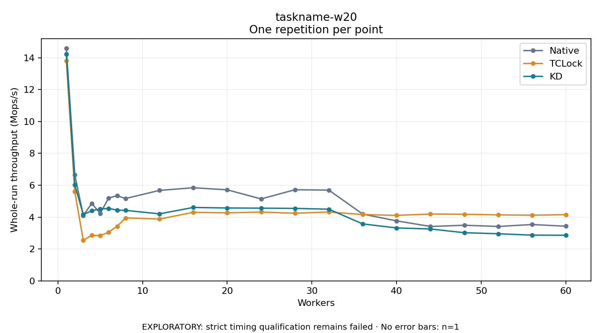

# taskname-w20

One timed repetition per point; no repeat variability estimate.
EXPLORATORY: strict timing qualification remains failed. Rates include post-lock work. Failed, unrun or score-ineligible cases have no plotted rate.

| Workers | Native Mops/s | TCLock Mops/s | KD Mops/s | KD execution |
| ---: | ---: | ---: | ---: | --- |
| 1 | 14.591 | 13.802 | 14.239 | NO_JIT |
| 2 | 6.664 | 5.605 | 6.021 | NO_JIT |
| 3 | 4.100 | 2.543 | 4.165 | NO_JIT |
| 4 | 4.857 | 2.858 | 4.397 | NO_JIT |
| 5 | 4.233 | 2.837 | 4.517 | NO_JIT |
| 6 | 5.201 | 3.055 | 4.543 | NO_JIT |
| 7 | 5.342 | 3.428 | 4.441 | NO_JIT |
| 8 | 5.168 | 3.950 | 4.423 | RETURNED_JIT |
| 12 | 5.676 | 3.879 | 4.205 | RETURNED_JIT |
| 16 | 5.842 | 4.300 | 4.608 | RETURNED_JIT |
| 20 | 5.713 | 4.271 | 4.572 | NO_JIT |
| 24 | 5.142 | 4.317 | 4.562 | NO_JIT |
| 28 | 5.718 | 4.243 | 4.548 | RETURNED_JIT |
| 32 | 5.693 | 4.320 | 4.497 | NO_JIT |
| 36 | 4.187 | 4.163 | 3.573 | RETURNED_JIT |
| 40 | 3.765 | 4.108 | 3.321 | NO_JIT |
| 44 | 3.413 | 4.195 | 3.256 | RETURNED_JIT |
| 48 | 3.490 | 4.180 | 3.021 | NO_JIT |
| 52 | 3.414 | 4.140 | 2.957 | NO_JIT |
| 56 | 3.535 | 4.120 | 2.869 | NO_JIT |
| 60 | 3.428 | 4.154 | 2.862 | NO_JIT |

[Full receipt table](table.csv)

