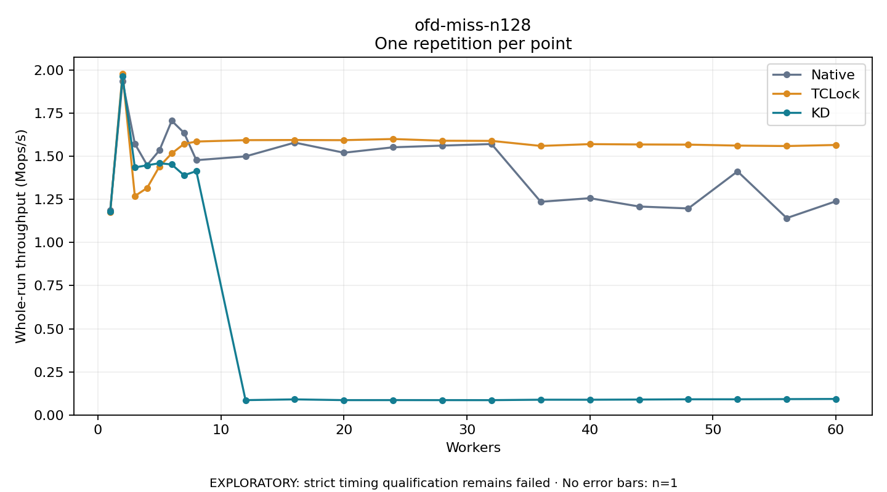

# ofd-miss-n128

One timed repetition per point; no repeat variability estimate.
EXPLORATORY: strict timing qualification remains failed. Rates include post-lock work. Failed, unrun or score-ineligible cases have no plotted rate.

| Workers | Native Mops/s | TCLock Mops/s | KD Mops/s | KD execution |
| ---: | ---: | ---: | ---: | --- |
| 1 | 1.188 | 1.176 | 1.179 | NO_JIT |
| 2 | 1.934 | 1.979 | 1.962 | NO_JIT |
| 3 | 1.572 | 1.269 | 1.435 | NO_JIT |
| 4 | 1.448 | 1.316 | 1.447 | NO_JIT |
| 5 | 1.534 | 1.440 | 1.460 | NO_JIT |
| 6 | 1.705 | 1.516 | 1.452 | NO_JIT |
| 7 | 1.636 | 1.571 | 1.390 | NO_JIT |
| 8 | 1.477 | 1.585 | 1.414 | NO_JIT |
| 12 | 1.499 | 1.593 | 0.086 | RETURNED_JIT |
| 16 | 1.579 | 1.594 | 0.090 | RETURNED_JIT |
| 20 | 1.520 | 1.593 | 0.086 | RETURNED_JIT |
| 24 | 1.552 | 1.600 | 0.086 | RETURNED_JIT |
| 28 | 1.561 | 1.590 | 0.086 | RETURNED_JIT |
| 32 | 1.571 | 1.589 | 0.086 | RETURNED_JIT |
| 36 | 1.236 | 1.560 | 0.088 | RETURNED_JIT |
| 40 | 1.257 | 1.570 | 0.088 | RETURNED_JIT |
| 44 | 1.208 | 1.568 | 0.089 | RETURNED_JIT |
| 48 | 1.197 | 1.567 | 0.091 | RETURNED_JIT |
| 52 | 1.412 | 1.562 | 0.091 | RETURNED_JIT |
| 56 | 1.141 | 1.559 | 0.092 | RETURNED_JIT |
| 60 | 1.239 | 1.565 | 0.093 | RETURNED_JIT |

[Full receipt table](table.csv)

