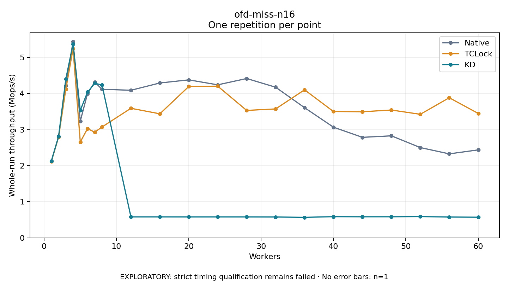

# ofd-miss-n16

One timed repetition per point; no repeat variability estimate.
EXPLORATORY: strict timing qualification remains failed. Rates include post-lock work. Failed, unrun or score-ineligible cases have no plotted rate.

| Workers | Native Mops/s | TCLock Mops/s | KD Mops/s | KD execution |
| ---: | ---: | ---: | ---: | --- |
| 1 | 2.131 | 2.116 | 2.130 | NO_JIT |
| 2 | 2.799 | 2.792 | 2.812 | NO_JIT |
| 3 | 4.222 | 4.120 | 4.402 | NO_JIT |
| 4 | 5.442 | 5.242 | 5.376 | NO_JIT |
| 5 | 3.236 | 2.657 | 3.532 | NO_JIT |
| 6 | 3.999 | 3.028 | 4.040 | NO_JIT |
| 7 | 4.318 | 2.930 | 4.285 | NO_JIT |
| 8 | 4.119 | 3.073 | 4.240 | NO_JIT |
| 12 | 4.092 | 3.592 | 0.581 | RETURNED_JIT |
| 16 | 4.294 | 3.439 | 0.581 | RETURNED_JIT |
| 20 | 4.380 | 4.197 | 0.580 | RETURNED_JIT |
| 24 | 4.242 | 4.205 | 0.580 | RETURNED_JIT |
| 28 | 4.418 | 3.533 | 0.580 | RETURNED_JIT |
| 32 | 4.176 | 3.574 | 0.578 | RETURNED_JIT |
| 36 | 3.609 | 4.104 | 0.569 | RETURNED_JIT |
| 40 | 3.068 | 3.502 | 0.587 | RETURNED_JIT |
| 44 | 2.787 | 3.496 | 0.584 | RETURNED_JIT |
| 48 | 2.829 | 3.544 | 0.584 | RETURNED_JIT |
| 52 | 2.503 | 3.426 | 0.589 | RETURNED_JIT |
| 56 | 2.329 | 3.884 | 0.577 | RETURNED_JIT |
| 60 | 2.439 | 3.450 | 0.572 | RETURNED_JIT |

[Full receipt table](table.csv)

