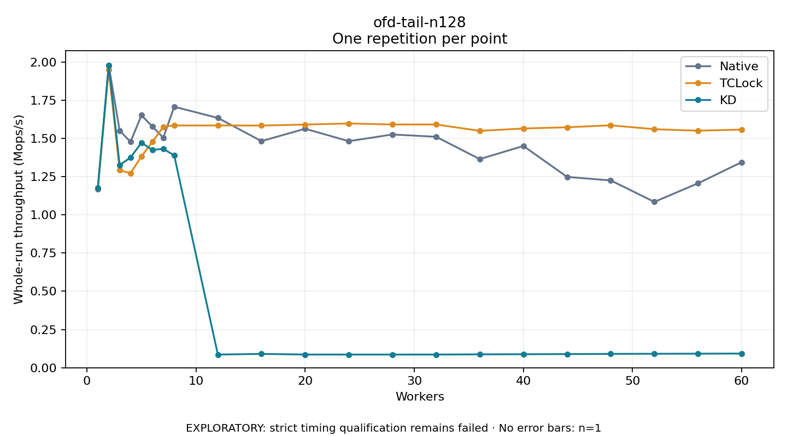

# ofd-tail-n128

One timed repetition per point; no repeat variability estimate.
EXPLORATORY: strict timing qualification remains failed. Rates include post-lock work. Failed, unrun or score-ineligible cases have no plotted rate.

| Workers | Native Mops/s | TCLock Mops/s | KD Mops/s | KD execution |
| ---: | ---: | ---: | ---: | --- |
| 1 | 1.168 | 1.173 | 1.176 | NO_JIT |
| 2 | 1.977 | 1.949 | 1.979 | NO_JIT |
| 3 | 1.551 | 1.292 | 1.325 | NO_JIT |
| 4 | 1.477 | 1.272 | 1.375 | NO_JIT |
| 5 | 1.651 | 1.382 | 1.471 | NO_JIT |
| 6 | 1.577 | 1.477 | 1.425 | NO_JIT |
| 7 | 1.504 | 1.576 | 1.431 | NO_JIT |
| 8 | 1.707 | 1.584 | 1.389 | NO_JIT |
| 12 | 1.634 | 1.584 | 0.086 | RETURNED_JIT |
| 16 | 1.482 | 1.584 | 0.091 | RETURNED_JIT |
| 20 | 1.563 | 1.590 | 0.086 | RETURNED_JIT |
| 24 | 1.481 | 1.597 | 0.086 | RETURNED_JIT |
| 28 | 1.525 | 1.591 | 0.086 | RETURNED_JIT |
| 32 | 1.510 | 1.591 | 0.086 | RETURNED_JIT |
| 36 | 1.364 | 1.549 | 0.088 | RETURNED_JIT |
| 40 | 1.450 | 1.564 | 0.088 | RETURNED_JIT |
| 44 | 1.248 | 1.572 | 0.089 | RETURNED_JIT |
| 48 | 1.225 | 1.585 | 0.091 | RETURNED_JIT |
| 52 | 1.085 | 1.560 | 0.091 | RETURNED_JIT |
| 56 | 1.206 | 1.550 | 0.092 | RETURNED_JIT |
| 60 | 1.344 | 1.557 | 0.093 | RETURNED_JIT |

[Full receipt table](table.csv)

