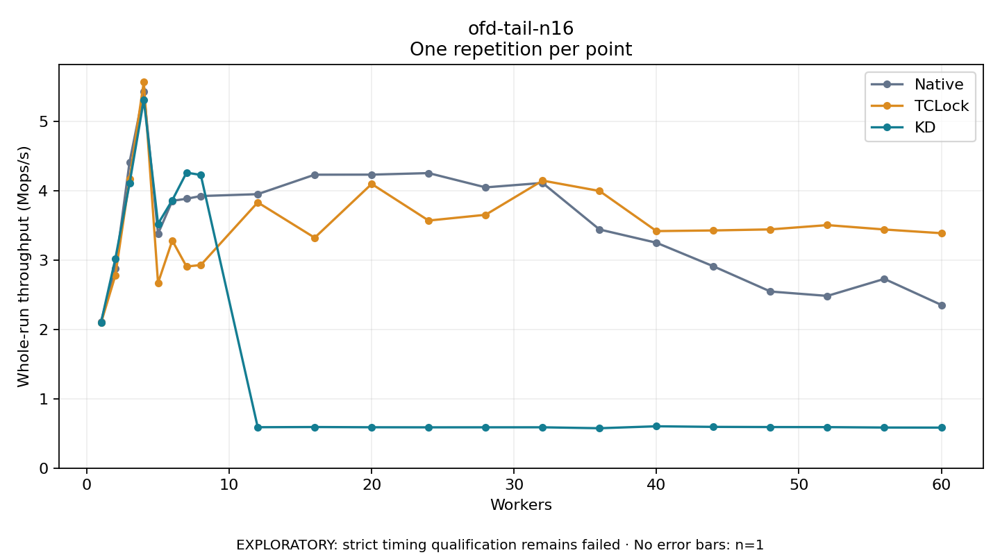

# ofd-tail-n16

One timed repetition per point; no repeat variability estimate.
EXPLORATORY: strict timing qualification remains failed. Rates include post-lock work. Failed, unrun or score-ineligible cases have no plotted rate.

| Workers | Native Mops/s | TCLock Mops/s | KD Mops/s | KD execution |
| ---: | ---: | ---: | ---: | --- |
| 1 | 2.114 | 2.098 | 2.103 | NO_JIT |
| 2 | 2.882 | 2.777 | 3.019 | NO_JIT |
| 3 | 4.413 | 4.168 | 4.106 | NO_JIT |
| 4 | 5.433 | 5.572 | 5.313 | NO_JIT |
| 5 | 3.381 | 2.671 | 3.524 | NO_JIT |
| 6 | 3.855 | 3.283 | 3.864 | NO_JIT |
| 7 | 3.886 | 2.908 | 4.262 | NO_JIT |
| 8 | 3.924 | 2.929 | 4.229 | NO_JIT |
| 12 | 3.952 | 3.833 | 0.590 | RETURNED_JIT |
| 16 | 4.233 | 3.323 | 0.593 | RETURNED_JIT |
| 20 | 4.234 | 4.099 | 0.589 | RETURNED_JIT |
| 24 | 4.256 | 3.571 | 0.588 | RETURNED_JIT |
| 28 | 4.050 | 3.654 | 0.589 | RETURNED_JIT |
| 32 | 4.114 | 4.148 | 0.589 | RETURNED_JIT |
| 36 | 3.442 | 3.998 | 0.575 | RETURNED_JIT |
| 40 | 3.251 | 3.419 | 0.603 | RETURNED_JIT |
| 44 | 2.911 | 3.428 | 0.595 | RETURNED_JIT |
| 48 | 2.547 | 3.444 | 0.592 | RETURNED_JIT |
| 52 | 2.484 | 3.506 | 0.591 | RETURNED_JIT |
| 56 | 2.730 | 3.442 | 0.585 | RETURNED_JIT |
| 60 | 2.354 | 3.389 | 0.584 | RETURNED_JIT |

[Full receipt table](table.csv)

